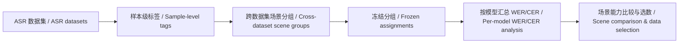

<div align="center">

# SureTagger

**让 ASR 评测从数据集平均错误率走向可解释的声学场景。**

**From dataset-level error rates to interpretable acoustic conditions for ASR.**

[项目动机 / Motivation](#项目动机--motivation) · [方法 / Approach](#方法--approach) · [快速开始 / Quick Start](#快速开始--quick-start) · [实验结果 / Results](#实验结果--results) · [项目视频 / Video](#项目视频--video)

</div>

## 项目动机 / Motivation

现有 ASR 评测通常以数据集为单位，最终报告整体 WER/CER。同一个平均错误率可能掩盖完全不同的失败来源：多人同时说话、低信噪比、背景音乐、混响，或语言差异。仅凭数据集名称，很难判断模型究竟在哪些条件下失效，也难以据此选择有针对性的训练数据。

ASR evaluations commonly report an aggregate WER/CER for each dataset. That number can hide very different failure modes, such as overlapping speakers, low SNR, background music, reverberation, or language variation. A dataset name alone does not tell us which conditions cause errors or which training examples might help.

SureTagger 为已有数据集补充**样本级、可追溯的标签**，再跨数据集组织可比较的场景。目标是按条件而非按来源分析 ASR 表现，为细粒度 leaderboard 和训练数据筛选提供基础。

SureTagger adds **traceable, sample-level labels** to existing datasets and organizes clips by comparable conditions across sources. This supports condition-level ASR analysis, finer-grained leaderboards, and targeted training-data selection.

## 方法 / Approach



1. **标注 / Tag.** 从音频及允许的输入信息生成结构化声学、声音事件、说话人和语言标签；可选的描述层对标签进行语言核验和语义补充。
2. **分组 / Group.** 使用结构化标签构造跨数据集的场景分组。当前 `clustering/` 实现 k-medoids 候选搜索与确定性的 split/merge，输出样本到匿名簇的分配及簇画像。
3. **诊断 / Diagnose.** 分组冻结后，按模型、语言和有效样本覆盖率分析 WER/CER。默认标签驱动流程不使用错误率来决定分组，避免用被测模型的表现定义场景。
4. **应用 / Apply.** 将场景差异用于细粒度模型比较，并识别值得补充的训练样本；公开 leaderboard 与选数策略是基于上述产物的后续工作。

The pipeline tags samples, groups them using acoustic evidence, freezes assignments, and only then analyzes WER/CER by model. A public leaderboard and training-data selection policy are planned downstream uses of these artifacts.

| 标签维度 / Tag family | 示例 / Examples | 用途 / What it captures |
| --- | --- | --- |
| 基础声学与质量 / Acoustics & quality | 时长、非语音占比、SNR、DNSMOS | 片段长度、语音密度、噪声和感知质量 / duration, speech density, noise, perceived quality |
| 空间声学 / Room acoustics | RT60、C50 | 混响衰减与语音清晰度 / reverberation and clarity |
| 声音事件 / Sound events | 音乐、歌声、背景噪声类别 | 音乐和其他干扰声 / music and other interfering sounds |
| 说话人结构 / Speaker structure | 人数、轮换、重叠比例 | 多人交互及同时发言 / turns and overlap |
| 语言与文本 / Language & text | 语种、词数、重复、填充词 | 语言覆盖和文本特征 / language coverage and text properties |

> **能力边界 / Current boundary:** `room_acoustic.far_field` 目前是预留字段，输出为 `null`。远场场景需要额外证据与验证；当前 RT60/C50 不能直接当作远近场标签。标签表示可观察的条件，不自动证明录音地点或设备类型。 / `room_acoustic.far_field` is reserved and currently emits `null`. RT60/C50 alone do not establish recording distance, location, or device type.

## 仓库内容 / Repository

| 目录 / Directory | 内容 / Contents |
| --- | --- |
| [`sure-tagger-main/`](sure-tagger-main/README.md) | 样本级标签流水线、schema、模型适配器和测试 / tagging pipeline, schemas, adapters, tests |
| [`compare/`](compare/dataset/benchmark/README.md) | 650 条结构性 benchmark、描述性评分和完整运行入口 / 650-sample structural benchmark, descriptive scoring, end-to-end launchers |
| [`clustering/`](clustering/README.md) | 标签驱动的 k-medoids 场景分组及冻结分组后的 WER/CER 诊断 / tag-based scene clustering and post-assignment WER/CER diagnostics |

当前仓库提供打标、benchmark 评分、场景聚类和错误率诊断代码。**尚未附带公开的场景 leaderboard、完整实验结果图或宣传视频。** 本源码包也不包含模型权重、完整音频数据、私有运行环境、API 凭据和运行产物。

The repository contains tagging, benchmark scoring, scene clustering, and error-rate diagnostics. A public scene leaderboard, complete result figures, and a project video are **not included yet**. Model weights, full audio datasets, private runtimes, API credentials, and generated outputs are external to this source package.

## 快速开始 / Quick Start

**1. 生成样本标签 / Tag samples.** 输入为 raw-only JSONL manifest；模型和运行环境需按[主程序说明](sure-tagger-main/README.md)在本机配置。字段定义和输入示例见[标签与方法文档](sure-tagger-main/docs/tags-and-methods.md)。

The input is a raw-only JSONL manifest. Configure local models and runtimes as described in the [tagger guide](sure-tagger-main/README.md); see [tags and methods](sure-tagger-main/docs/tags-and-methods.md) for the input contract and field definitions.

```bash
cd sure-tagger-main
python3 scripts/run_tagger.py \
  --manifest /path/to/manifest.jsonl \
  --output /path/to/tags.jsonl
cd ..
```

**2. 跨数据集场景分组 / Group scenes across datasets.** 将标签、样本索引和 manifest 放在同一套样本顺序下；下例从仓库根目录运行，不读取 WER/CER。具体输入契约和可选诊断命令见[聚类说明](clustering/README.md)。

Keep tags, sample indices, and the manifest aligned in the same sample order. Run the following from the repository root; it does not read WER/CER. See the [clustering guide](clustering/README.md) for the input contract and optional diagnostics.

```bash
python3 clustering/scripts/cluster_scenes.py \
  --tags /path/to/tags.jsonl \
  --index-map /path/to/index_map.jsonl \
  --sampled-manifest /path/to/manifest.jsonl \
  --output-dir /path/to/scene-clusters \
  --cluster-methods kmedoids --k-min 6 --k-max 12 --seeds 0,1,2 \
  --no-wer-filter --skip-diagnostics
```

输出包括 `cluster_assignments.jsonl`、`cluster_summary.json` 和 `run_metadata.json`。聚类与后续错误率诊断仅依赖 Python 3.9+ 标准库，无需 GPU；打标需要相应模型与运行环境。

Outputs include `cluster_assignments.jsonl`, `cluster_summary.json`, and `run_metadata.json`. Clustering and subsequent error-rate diagnostics use only the Python 3.9+ standard library and do not require a GPU; tagging requires the configured models and runtimes.

**3. 运行结构性 benchmark / Run the structural benchmark.** 单卡与八卡完整流程分别由 `compare/eval/run_sure_tagger_pipeline_1.sh` 和 `compare/eval/run_sure_tagger_pipeline_8.sh` 启动。先用 `--check-inputs` 验证外部 benchmark、runtime 和 GT，再运行模型和 API 阶段。benchmark 共 650 条；仅在设置 `ALLOW_FROZEN_GT_EXCLUSIONS=1` 时，语义评分可沿用原冻结 GT 的 648 条口径。详情见[benchmark 文档](compare/dataset/benchmark/README.md)及[入口脚本](compare/eval/run_sure_tagger_pipeline.sh)。

The one-GPU and eight-GPU launchers run the full structural and descriptive benchmark. Use `--check-inputs` to validate external assets before inference or API calls. The benchmark has 650 samples; the frozen 648-sample semantic denominator is available only with `ALLOW_FROZEN_GT_EXCLUSIONS=1`. See the [benchmark guide](compare/dataset/benchmark/README.md) and [launcher](compare/eval/run_sure_tagger_pipeline.sh) for details.

```bash
export PYTHON_BIN=/path/to/python
export BENCHMARK_ROOT=/path/to/benchmark
export RUNTIME_ROOT=/path/to/runtime
export GT_ROOT=/path/to/descriptive_gt
export DEEPSEEK_API_FILE=/private/deepseek-api.txt
export OUTPUT_ROOT=/path/to/new_output

bash compare/eval/run_sure_tagger_pipeline_1.sh --check-inputs
bash compare/eval/run_sure_tagger_pipeline_1.sh
# 八卡 / Eight GPUs: compare/eval/run_sure_tagger_pipeline_8.sh
```

## 实验结果 / Results

以下位置预留给正式发布的结果；目前不展示未经核实的数字。建议报告每个场景的样本数、标签覆盖率、语言构成、各模型有效评分覆盖率和 WER/CER，并给出与数据集整体结果的对照。

Reserved for verified results. A scene-level report should show sample count, tag coverage, language mix, valid score coverage by model, WER/CER, and the corresponding dataset-level baseline.

| 场景分布 / Scene distribution | 场景能力对比 / Scene-level comparison |
| :---: | :---: |
| *图表待发布 / Figure coming soon* | *图表待发布 / Figure coming soon* |

<!-- 发布时将场景分布图和模型对比图放入 docs/assets/，并用实际图片链接替换上表占位。 -->

## 项目视频 / Video

> **视频待发布 / Project video coming soon.**

<!-- 发布时在此加入视频缩略图与正式视频链接；避免提交失效的占位 URL。 -->

## 文档与验证 / Documentation & Verification

- [标签字段、方法和 JSON 示例 / Tags, methods & JSON examples](sure-tagger-main/docs/tags-and-methods.md)
- [场景分组方法与错误率边界 / Scene grouping & error-rate boundary](compare/docs/multi-data-scene-classification.md)
- [Benchmark 构成 / Benchmark composition](compare/docs/benchmark-650-dataset-composition.md)
- [评分标准 / Scoring standard](compare/dataset/benchmark/SCORING_STANDARD.md)

```bash
cd sure-tagger-main && python3 -m unittest discover -s tests
cd ..
python3 -m unittest discover -s compare/eval/tests
python3 compare/eval/test_sure_tagger_pipeline_launchers.py
PYTHONDONTWRITEBYTECODE=1 python3 -m unittest discover -s clustering/tests -p 'test_*.py'
```
