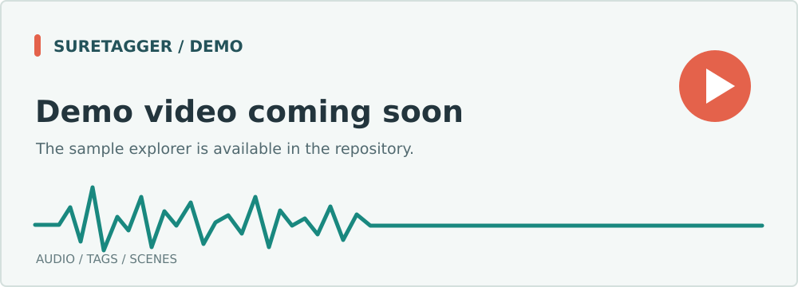
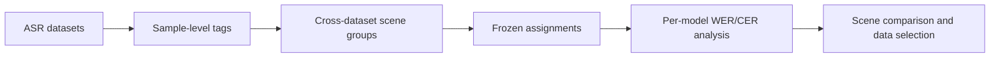

<div align="center">
  <h1>
    <picture>
      <source media="(prefers-color-scheme: dark)" srcset="docs/assets/suretagger-wordmark-dark.png">
      
    </picture>
  </h1>
  <p><strong>Understand where ASR fails.</strong></p>
  <p>Sample-level audio tags · Cross-dataset scenes · Condition-level evaluation</p>
  <p><strong>English</strong> &nbsp;·&nbsp; <a href="README_zh.md">简体中文</a></p>
  <p>
    <a href="#demo">Demo</a> &nbsp;·&nbsp;
    <a href="#why-suretagger">Motivation</a> &nbsp;·&nbsp;
    <a href="#how-it-works">Method</a> &nbsp;·&nbsp;
    <a href="#quick-start">Quick start</a> &nbsp;·&nbsp;
    <a href="#results">Results</a>
  </p>
</div>

## Demo

<p align="center"></p>

The [sample explorer](sure-tagger-main/demo/index.html) lets you switch between recordings, play audio, inspect sample-level tags, and review dataset and tag coverage. A project walkthrough video will appear here when it is ready.

> **Demo video coming soon.** The source release does not include generated demo data or audio, so there is no public interactive demo to link yet.

To run the browser demo locally, place the selected audio files in `sure-tagger-main/demo/assets/audio/`, then generate `data.js` from a matching manifest and tags-only output. Use paths inside `sure-tagger-main/`:

```bash
cd sure-tagger-main
python3 scripts/build_demo_data.py \
  --manifest "$PWD/path/to/manifest.jsonl" \
  --tags "$PWD/path/to/tags.jsonl" \
  --audio-dir "$PWD/demo/assets/audio" \
  --output "$PWD/demo/data.js"
python3 demo/serve.py
# Open http://localhost:8765
```

## Why SureTagger

Most ASR evaluations report one WER or CER for an entire dataset. That average can conceal different failure modes: overlapping speakers, low SNR, background music, reverberation, and language variation. Dataset names alone rarely explain which acoustic conditions cause errors or which training examples are worth adding.

SureTagger adds **traceable, sample-level labels** to existing ASR datasets. It organizes recordings by observable conditions across dataset boundaries, so model behavior can be compared by scene rather than only by source. These groups can support a fine-grained leaderboard and targeted training-data selection.

## How It Works



1. **Tag the audio.** Extract structured acoustic, sound-event, speaker, and language labels. An optional language-model layer verifies language and adds descriptions.
2. **Group by condition.** The current `clustering/` package searches k-medoids candidates and applies deterministic split/merge rules to produce anonymous scene assignments and profiles.
3. **Diagnose after grouping.** Freeze assignments before analyzing WER/CER by model, language, and valid-score coverage. The default tag-only workflow does not use model errors to define its scenes.
4. **Use the findings.** Scene-level model comparisons and training-data selection are downstream goals; a public scene leaderboard is not included in this source release.

| Tag family | Examples | What it captures |
| --- | --- | --- |
| Acoustics and quality | Duration, nonspeech ratio, SNR, DNSMOS | Clip length, speech density, noise, perceived quality |
| Room acoustics | RT60, C50 | Reverberation and clarity |
| Sound events | Music, singing, background-noise classes | Interfering sounds |
| Speaker structure | Speaker count, turns, overlap ratio | Multi-speaker interaction |
| Language and text | Language, word count, repetitions, fillers | Language coverage and text properties |

> **Current boundary:** `room_acoustic.far_field` is reserved and currently emits `null`. RT60 and C50 alone do not establish recording distance, location, or device type.

## Repository

| Directory | Contents |
| --- | --- |
| [`sure-tagger-main/`](sure-tagger-main/README.md) | Sample-level tagging pipeline, schemas, model adapters, and tests |
| [`compare/`](compare/dataset/benchmark/README.md) | 650-sample structural benchmark, descriptive scoring, and end-to-end launchers |
| [`clustering/`](clustering/README.md) | Tag-based k-medoids grouping and post-assignment WER/CER diagnostics |

The repository provides tagging, benchmark scoring, scene clustering, and error-rate diagnostics. Model weights, full audio datasets, private runtimes, API credentials, and generated results are external to this source package.

## Quick Start

### Tag samples

The input is a raw-only JSONL manifest. Configure local models and runtimes using the [tagger guide](sure-tagger-main/README.md); see [tags and methods](sure-tagger-main/docs/tags-and-methods.md) for the input contract and field definitions.

```bash
cd sure-tagger-main
python3 scripts/run_tagger.py \
  --manifest /path/to/manifest.jsonl \
  --output /path/to/tags.jsonl
cd ..
```

### Group scenes across datasets

Tags, the sample index, and the manifest must contain the same samples in the same order. The example below runs from the repository root and does not read WER/CER. See the [clustering guide](clustering/README.md) for the full input contract and optional diagnostics.

```bash
python3 clustering/scripts/cluster_scenes.py \
  --tags /path/to/tags.jsonl \
  --index-map /path/to/index_map.jsonl \
  --sampled-manifest /path/to/manifest.jsonl \
  --output-dir /path/to/scene-clusters \
  --cluster-methods kmedoids --k-min 6 --k-max 12 --seeds 0,1,2 \
  --no-wer-filter --skip-diagnostics
```

The output contains `cluster_assignments.jsonl`, `cluster_summary.json`, and `run_metadata.json`. Clustering and subsequent error-rate diagnostics use only the Python 3.9+ standard library and need no GPU. Tagging requires configured models and runtimes.

### Run the benchmark

The one-GPU and eight-GPU launchers run structural tagging, descriptions, and scoring. Validate the external benchmark, runtime, and ground-truth assets before inference or API calls:

```bash
export PYTHON_BIN=/path/to/python
export BENCHMARK_ROOT=/path/to/benchmark
export RUNTIME_ROOT=/path/to/runtime
export GT_ROOT=/path/to/descriptive_gt
export DEEPSEEK_API_FILE=/private/deepseek-api.txt
export OUTPUT_ROOT=/path/to/new_output

bash compare/eval/run_sure_tagger_pipeline_1.sh --check-inputs
bash compare/eval/run_sure_tagger_pipeline_1.sh
# Eight GPUs: compare/eval/run_sure_tagger_pipeline_8.sh
```

The benchmark contains 650 samples. The frozen 648-sample semantic scoring denominator is available only with `ALLOW_FROZEN_GT_EXCLUSIONS=1`. See the [benchmark guide](compare/dataset/benchmark/README.md) and [launcher](compare/eval/run_sure_tagger_pipeline.sh) for details.

## Results

Verified scene-level results will be added here. Each comparison should report scene sample count, tag coverage, language mix, valid-score coverage per model, WER/CER, and the dataset-level baseline.

| Scene distribution | Per-scene model comparison |
| :---: | :---: |
| *Figure coming soon* | *Figure coming soon* |

<!-- Add verified figures under docs/assets/ and replace the placeholders above. -->

## Documentation

- [Tag fields, methods, and JSON examples](sure-tagger-main/docs/tags-and-methods.md)
- [Scene grouping and error-rate boundary](compare/docs/multi-data-scene-classification.md)
- [Benchmark composition](compare/docs/benchmark-650-dataset-composition.md)
- [Scoring standard](compare/dataset/benchmark/SCORING_STANDARD.md)

```bash
cd sure-tagger-main && python3 -m unittest discover -s tests
cd ..
python3 -m unittest discover -s compare/eval/tests
python3 compare/eval/test_sure_tagger_pipeline_launchers.py
PYTHONDONTWRITEBYTECODE=1 python3 -m unittest discover -s clustering/tests -p 'test_*.py'
```
