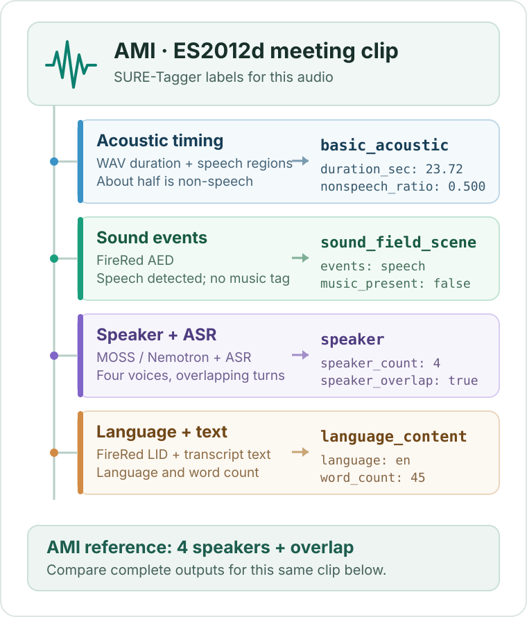

<p align="center"></p>

<h1 align="center">SURE-Tagger</h1>

<h2 align="center">A semi-structured representation of speech that lets agents truly understand and analyze sound</h2>

<p align="center"><strong>English</strong> · <a href="README.zh-CN.md">简体中文</a></p>

<p align="center"><a href="#motivation">Motivation</a> · <a href="#demo">Demo</a> · <a href="#how-it-works">How it works</a> · <a href="#tag-bench">Tag-Bench</a> · <a href="#paper-results">Results</a> · <a href="#usage">Usage</a> · <a href="#license">License</a></p>

SURE-Tagger turns evidence from specialized speech models into queryable tags and descriptions. It keeps `null` when evidence is insufficient. The research explores how these representations support evaluation across datasets and targeted data selection; this repository provides tagging, description, and scoring entry points.

<p align="center"><video src="https://github.com/user-attachments/assets/e2543c8b-6002-40fd-b9ba-c3a99d7cf16f" controls playsinline preload="metadata" poster="./assets/readme/video/suretagger-intro-zh-poster.jpg" width="100%" aria-label="SURE-Tagger introduction video with Chinese narration">SURE-Tagger introduction video</video></p>

<p align="center"><sub>Introduction video · Chinese narration</sub></p>

<a id="motivation"></a>

## Motivation

A free-form caption can summarize a recording, but it cannot tell whether an omitted property is absent or simply unsupported by evidence. Explicit fields, descriptions, and `null` make speech conditions easier to query and evaluate individually.

<p align="center"></p>

<p align="center"><sub>Structured tags make missing evidence explicit.</sub></p>

<a id="demo"></a>

## Demo · Audio to tags

Hear this [AMI meeting clip](assets/readme/tagbench/samples/ES2012d_utterance_00018/audio.wav), then follow its SURE-Tagger labels from audio to structured evidence.

<p align="center"><a href="./assets/readme/demo-tag-tree-en.svg"></a></p>

<details>
<summary>View this clip's tag excerpt</summary>

Values from the [complete SURE-Tagger prediction](assets/readme/tagbench/samples/ES2012d_utterance_00018/full_predictions.json):

```json
{
  "basic_acoustic": {"duration_sec": 23.72, "nonspeech_ratio": 0.500422},
  "sound_field_scene": {"speech_music_events": ["speech"], "music_present": false},
  "speaker": {"speaker_count": 4, "speaker_overlap": true},
  "language_content": {"language": "en", "word_count": 45}
}
```

</details>

Explore five Tag-Bench clips with complete same-audio predictions from SURE-Tagger, Captioner, and Qwen3-Omni:

| Clip | Listen for | Files |
| --- | --- | --- |
| AMI · `ES2012d` | Four speakers and overlap | [Listen](assets/readme/tagbench/samples/ES2012d_utterance_00018/audio.wav) · [Full predictions](assets/readme/tagbench/samples/ES2012d_utterance_00018/full_predictions.json) |
| AMI · `EN2001e` | Two speakers and brief overlap | [Listen](assets/readme/tagbench/samples/EN2001e_utterance_00071/audio.wav) · [Full predictions](assets/readme/tagbench/samples/EN2001e_utterance_00071/full_predictions.json) |
| FLEURS · Russian | Language and speech content | [Listen](assets/readme/tagbench/samples/fleurs_t2_0347/audio.wav) · [Full predictions](assets/readme/tagbench/samples/fleurs_t2_0347/full_predictions.json) |
| DESED | Speech with a mechanical event | [Listen](assets/readme/tagbench/samples/t3_desed_0112/audio.wav) · [Full predictions](assets/readme/tagbench/samples/t3_desed_0112/full_predictions.json) |
| FSD50K | Music event missed by the tagger | [Listen](assets/readme/tagbench/samples/t3_fsd50k_0045/audio.wav) · [Full predictions](assets/readme/tagbench/samples/t3_fsd50k_0045/full_predictions.json) |

[All five samples and references](assets/readme/tagbench/README.md) · [Same-audio comparison](assets/readme/tagbench/COMPARISON.md) · [Audio attribution](assets/readme/tagbench/ATTRIBUTION.md)

For the complete fields and input format, see the [tag guide](sure-tagger-main/docs/tags-and-methods.md). The [interactive demo](sure-tagger-main/demo/index.html) needs your own audio and `demo/data.js`; [`build_demo_data.py`](sure-tagger-main/scripts/build_demo_data.py) prepares that data.

<a id="how-it-works"></a>

## How it works

Specialized observers collect acoustic, temporal, lexical, and speaker evidence. SURE-Tagger reconciles it into explicit fields and descriptions, then uses those fields to form comparable subsets across datasets.

<p align="center"><a href="./assets/readme/how-it-works.png"></a></p>

<a id="tag-bench"></a>

## Tag-Bench

Tag-Bench combines selected recordings from existing datasets with controlled synthetic scenarios. For the latter, an agent chooses attribute combinations, schedules speech generation and acoustic processing, then validates the resulting clips.

| Component | Source or process | Clips |
| --- | --- | ---: |
| Controlled synthesis | Agent-orchestrated generation and validation | 500 |
| Existing data · T1 | AMI meetings | 350 |
| Existing data · T2 | FLEURS, LibriSpeech | 150 |
| Existing data · T3 | DESED, FSD50K | 150 |
| **Total** | **Synthesis + existing data** | **1,150** |

<p align="center"></p>

<p align="center"><sub>Controlled synthesis and existing recordings together form Tag-Bench.</sub></p>

The repository's full evaluation launcher currently uses the existing-data subset; see its [composition](compare/docs/benchmark-650-dataset-composition.md) and [scoring rules](compare/docs/benchmark-v1-29-metrics.md).

<a id="paper-results"></a>

## Paper results

The radar plots compare attribute-level relative performance on existing and synthetic recordings. Each axis is normalized to its best method within that source; SURE-Tagger performs strongest across most speaker, temporal, and acoustic attributes.

<p align="center"><a href="./assets/readme/paper-results-rps.png"></a></p>

<a id="usage"></a>

## Usage

Prepare local model weights, a Python environment, and your own manifest as described in the [tagger guide](sure-tagger-main/README.md). Then run from the tagger directory:

```bash
cd sure-tagger-main
python3 scripts/run_tagger.py \
  --manifest /path/to/manifest.jsonl \
  --output /path/to/tags.jsonl
```

<details>
<summary>Full evaluation pipeline and test commands</summary>

The full launcher needs a benchmark, model-accessible runtime audio, descriptive ground truth, and external API credentials. See the [launcher](compare/eval/run_sure_tagger_pipeline.sh) for paths and GPU configuration. `--check-inputs` does not call models or APIs, but still requires the credential file to be readable.

```bash
# From the repository root
export PYTHON_BIN=/path/to/python
export BENCHMARK_ROOT=/path/to/benchmark
export RUNTIME_ROOT=/path/to/runtime
export GT_ROOT=/path/to/descriptive_gt
export DEEPSEEK_API_FILE=/private/deepseek-api.txt
export OUTPUT_ROOT=/path/to/new_output

bash compare/eval/run_sure_tagger_pipeline_1.sh --check-inputs
bash compare/eval/run_sure_tagger_pipeline_1.sh
# Eight GPUs: bash compare/eval/run_sure_tagger_pipeline_8.sh
```

| Evaluation scope | Clips | Setting |
| --- | ---: | --- |
| Existing-data structural benchmark | 650 | Default inputs |
| Original frozen descriptive ground truth | 648 | `ALLOW_FROZEN_GT_EXCLUSIONS=1` for the predefined missing clips only |

Use separate `OUTPUT_ROOT` / `STAGE_ROOT` directories for one-GPU and eight-GPU runs.

```bash
cd sure-tagger-main
python3 -m unittest discover -s tests
cd ..
python3 -m unittest discover -s compare/eval/tests
python3 compare/eval/test_sure_tagger_pipeline_launchers.py
PYTHONDONTWRITEBYTECODE=1 python3 -m unittest discover -s clustering/tests -p 'test_*.py' -v
```

</details>

Explore the [tagger](sure-tagger-main/README.md), [scoring and comparison](compare/docs/benchmark-v1-29-metrics.md), and standalone [k-medoids scene clustering](clustering/README.md).

<a id="license"></a>

## License

The repository does not currently include a `LICENSE` file, so no source-code license has been declared. External models and datasets follow their own terms; see the [demo audio attribution](assets/readme/tagbench/ATTRIBUTION.md).
