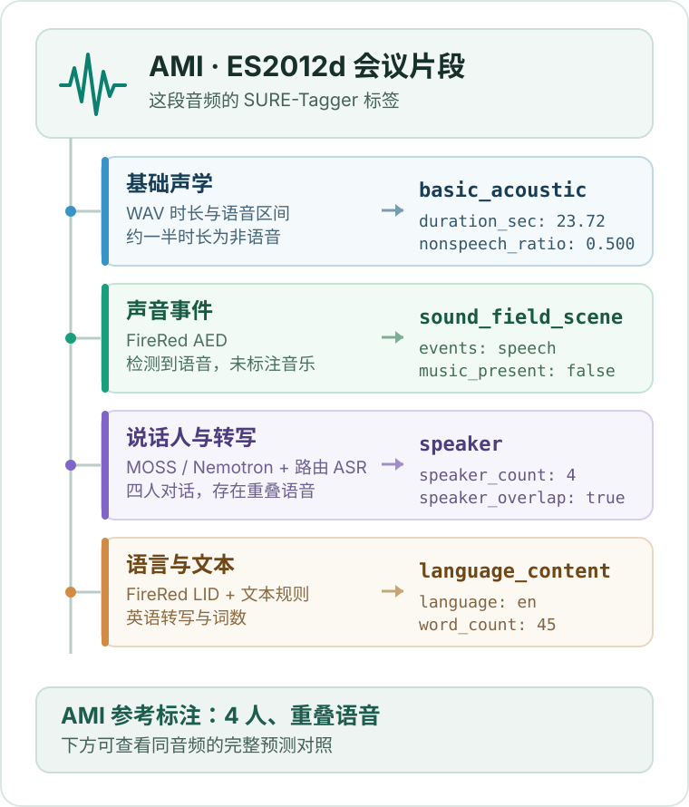

<p align="center"></p>

<h1 align="center">SURE-Tagger</h1>

<h2 align="center">一种语音的半结构化表征，让智能体真正听懂并分析声音</h2>

<p align="center"><a href="README.md">English</a> · <strong>简体中文</strong></p>

<p align="center"><a href="#motivation">项目动机</a> · <a href="#demo">Demo</a> · <a href="#how-it-works">工作原理</a> · <a href="#tag-bench">Tag-Bench</a> · <a href="#paper-results">论文结果</a> · <a href="#usage">使用方式</a> · <a href="#license">协议</a></p>

SURE-Tagger 将专项模型的语音证据整理为可查询的标签与描述，并在证据不足时保留 `null`。论文研究这些表示如何支持跨数据集的组合评测与目标数据选择；本仓库提供打标、描述和评分入口。

https://github.com/user-attachments/assets/e2543c8b-6002-40fd-b9ba-c3a99d7cf16f

<p align="center"><sub>SURE-Tagger 中文介绍视频</sub></p>

<a id="motivation"></a>

## 项目动机

自由文本 caption 能概述一段语音，却无法说明未提及的属性究竟不存在，还是缺少证据。显式字段、补充描述和 `null` 使语音条件可以被共同查询与逐项评测。

<p align="center"></p>

<p align="center"><sub>结构化标签让缺失的证据变得明确。</sub></p>

<a id="demo"></a>

## Demo · 从音频到标签

先[试听这段 AMI 会议音频](assets/readme/tagbench/samples/ES2012d_utterance_00018/audio.wav)，再顺着图表查看 SURE-Tagger 如何将其整理为结构化标签。

<p align="center"><a href="./assets/readme/demo-tag-tree-zh.svg"></a></p>

<details>
<summary>展开这段音频的标签节选</summary>

数值来自[完整的 SURE-Tagger 预测](assets/readme/tagbench/samples/ES2012d_utterance_00018/full_predictions.json)：

```json
{
  "basic_acoustic": {"duration_sec": 23.72, "nonspeech_ratio": 0.500422},
  "sound_field_scene": {"speech_music_events": ["speech"], "music_present": false},
  "speaker": {"speaker_count": 4, "speaker_overlap": true},
  "language_content": {"language": "en", "word_count": 45}
}
```

</details>

五段 Tag-Bench 音频均提供 SURE-Tagger、Captioner 与 Qwen3-Omni 对同一音频的完整预测：

| 样本 | 试听重点 | 资源 |
| --- | --- | --- |
| AMI · `ES2012d` | 四人对话与重叠语音 | [试听](assets/readme/tagbench/samples/ES2012d_utterance_00018/audio.wav) · [完整预测](assets/readme/tagbench/samples/ES2012d_utterance_00018/full_predictions.json) |
| AMI · `EN2001e` | 两人对话与短暂重叠 | [试听](assets/readme/tagbench/samples/EN2001e_utterance_00071/audio.wav) · [完整预测](assets/readme/tagbench/samples/EN2001e_utterance_00071/full_predictions.json) |
| FLEURS · 俄语 | 语种与语音内容 | [试听](assets/readme/tagbench/samples/fleurs_t2_0347/audio.wav) · [完整预测](assets/readme/tagbench/samples/fleurs_t2_0347/full_predictions.json) |
| DESED | 语音与机械事件 | [试听](assets/readme/tagbench/samples/t3_desed_0112/audio.wav) · [完整预测](assets/readme/tagbench/samples/t3_desed_0112/full_predictions.json) |
| FSD50K | 音乐事件被打标器漏检 | [试听](assets/readme/tagbench/samples/t3_fsd50k_0045/audio.wav) · [完整预测](assets/readme/tagbench/samples/t3_fsd50k_0045/full_predictions.json) |

[五条样本与参考信息](assets/readme/tagbench/README.md) · [同音频输出对照](assets/readme/tagbench/COMPARISON.md) · [音频来源与归属](assets/readme/tagbench/ATTRIBUTION.md)

[完整字段与输入格式](sure-tagger-main/docs/tags-and-methods.md)见标签文档。[交互演示页面](sure-tagger-main/demo/index.html)需自行准备音频和 `demo/data.js`，可用 [`build_demo_data.py`](sure-tagger-main/scripts/build_demo_data.py) 生成页面数据。

<a id="how-it-works"></a>

## 工作原理

专项模型分别提取声学、时间、词汇和说话人证据。SURE-Tagger 核对证据后生成明确的字段与描述，再用这些字段跨数据集组合可比较的样本。

<p align="center"><a href="./assets/readme/how-it-works.png"></a></p>

<a id="tag-bench"></a>

## Tag-Bench

Tag-Bench 将受控合成场景与现有数据集样本结合。合成部分从属性组合选定场景，由 agent 调度语音生成、时间安排和声学处理，再验证生成结果。

| 构成 | 来源或生成方式 | 样本数 |
| --- | --- | ---: |
| 受控合成 | Agent 调度工具生成并核验 | 500 |
| 现有数据集 · T1 | AMI 会议 | 350 |
| 现有数据集 · T2 | FLEURS、LibriSpeech | 150 |
| 现有数据集 · T3 | DESED、FSD50K | 150 |
| **合计** | **合成 + 现有数据集** | **1,150** |

<p align="center"></p>

<p align="center"><sub>受控合成与现有录音共同组成 Tag-Bench。</sub></p>

当前仓库的完整评测入口使用现有数据集子集；[数据构成](compare/docs/benchmark-650-dataset-composition.md)与[评分规则](compare/docs/benchmark-v1-29-metrics.md)另见文档。

<a id="paper-results"></a>

## 论文结果

雷达图对比现有录音与合成录音上的逐属性相对表现。每类数据的每个轴都以该轴最优方法归一化；SURE-Tagger 在多数说话人、时间与声学属性上表现领先。

<p align="center"><a href="./assets/readme/paper-results-rps.png"></a></p>

<a id="usage"></a>

## 使用方式

先按[主程序说明](sure-tagger-main/README.md)准备本地模型权重、Python 运行环境和自己的 manifest。在主程序目录运行：

```bash
cd sure-tagger-main
python3 scripts/run_tagger.py \
  --manifest /path/to/manifest.jsonl \
  --output /path/to/tags.jsonl
```

<details>
<summary>展开：完整评测流水线与测试命令</summary>

完整入口需要 benchmark、模型可见的 runtime 音频、描述性 GT 和仓库外的 API 凭据。各路径和 GPU 配置见[入口帮助](compare/eval/run_sure_tagger_pipeline.sh)；`--check-inputs` 不调用模型或 API，但仍要求凭据文件可读。

```bash
# 从仓库根目录运行
export PYTHON_BIN=/path/to/python
export BENCHMARK_ROOT=/path/to/benchmark
export RUNTIME_ROOT=/path/to/runtime
export GT_ROOT=/path/to/descriptive_gt
export DEEPSEEK_API_FILE=/private/deepseek-api.txt
export OUTPUT_ROOT=/path/to/new_output

bash compare/eval/run_sure_tagger_pipeline_1.sh --check-inputs
bash compare/eval/run_sure_tagger_pipeline_1.sh
# 八卡：bash compare/eval/run_sure_tagger_pipeline_8.sh
```

| 评测范围 | 样本数 | 入口设置 |
| --- | ---: | --- |
| 现有数据集结构性 benchmark | 650 | 默认输入 |
| 原冻结描述性 GT | 648 | `ALLOW_FROZEN_GT_EXCLUSIONS=1`，仅允许既定缺失样本 |

单卡与八卡运行请使用各自的 `OUTPUT_ROOT` / `STAGE_ROOT`。

```bash
cd sure-tagger-main
python3 -m unittest discover -s tests
cd ..
python3 -m unittest discover -s compare/eval/tests
python3 compare/eval/test_sure_tagger_pipeline_launchers.py
PYTHONDONTWRITEBYTECODE=1 python3 -m unittest discover -s clustering/tests -p 'test_*.py' -v
```

</details>

主程序：[sure-tagger-main](sure-tagger-main/README.md) · 评分与比较：[compare](compare/docs/benchmark-v1-29-metrics.md) · 独立的 k-medoids 场景聚类：[clustering](clustering/README.md)

<a id="license"></a>

## 协议

仓库目前没有 `LICENSE` 文件，尚未声明源码开源协议；外部模型与数据遵循各自条款。演示音频的来源见[归属说明](assets/readme/tagbench/ATTRIBUTION.md)。
