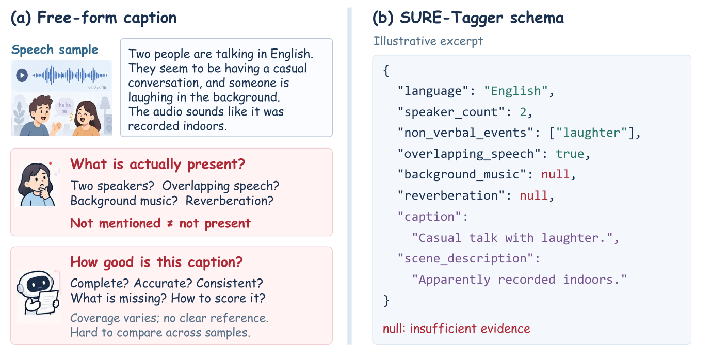
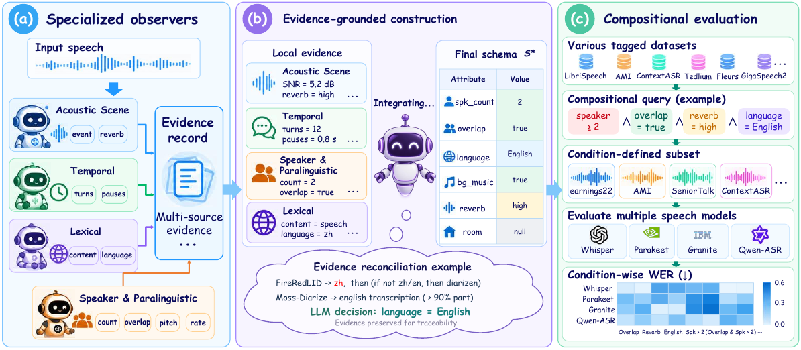
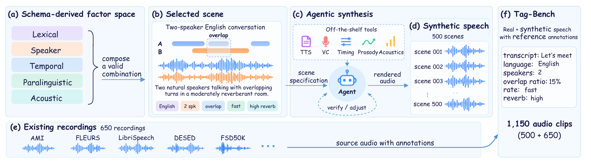
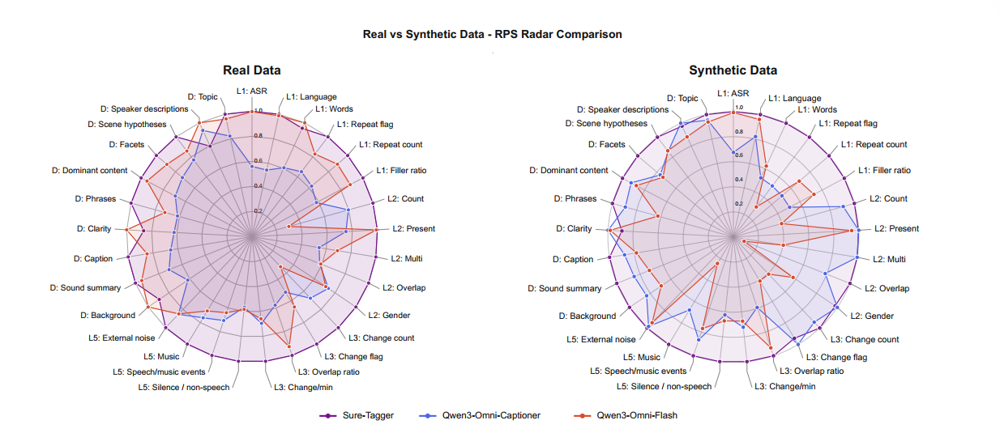
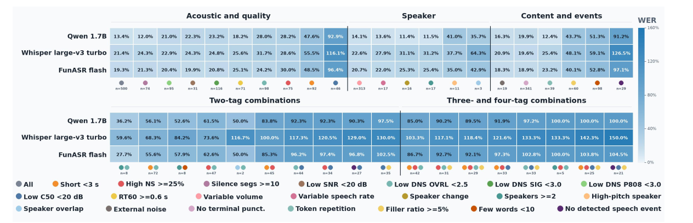

<p align="center"></p>

<h1 align="center">SURE-Tagger</h1>

<p align="center"><strong>让智能体听懂语音，并让声音信息可计算</strong><br><sub>通过丰富的半结构化表征</sub></p>

<p align="center">
<a href="https://me-chuan.github.io/sure-tagger/"><strong>交互演示 ↗</strong></a> ·
<a href="https://arxiv.org/abs/2610.32198"><strong>论文 ↗</strong></a> ·
<a href="#usage"><strong>快速开始</strong></a>
</p>

<p align="center"><a href="README.md">English</a> · <strong>简体中文</strong></p>

<p align="center"><sub>面向智能体、评测与分析的结构化语音理解。</sub></p>

<p align="center">
<a href="#motivation">项目动机</a> · <a href="#sure-tagger">SURE-Tagger</a> · <a href="#how-it-works">工作原理</a> · <a href="#tag-bench">Tag-Bench</a> · <a href="#system-performance">结果</a> · <a href="#citation">引用</a>
</p>

---

SURE-Tagger 将语音证据整理为可查询的标签与有证据支撑的描述。

<p align="center"><strong>1,150</strong> 条 Tag-Bench 音频 &nbsp;·&nbsp; <strong>77.28%</strong> 综合得分 &nbsp;·&nbsp; <strong>14.3%</strong> ASR 相对错误率下降</p>

https://github.com/user-attachments/assets/e2543c8b-6002-40fd-b9ba-c3a99d7cf16f

<p align="center"><sub>SURE-Tagger 中文介绍视频</sub></p>

<a id="motivation"></a>

---

## 项目动机

自由文本 caption 能概述一段语音，却无法说明未提及的属性究竟不存在，还是缺少证据。显式字段、补充描述和 `null` 使语音条件可以被共同查询与逐项评测。

<p align="center"></p>

<p align="center"><sub>结构化标签让缺失的证据变得明确。</sub></p>

<a id="sure-tagger"></a>
<a id="demo"></a>

---

## SURE-Tagger · 从音频到标签

半结构化标签将可查询的显式字段与简短描述放在一起；无法从证据确认的属性保留为 `null`。先[试听这段 AMI 会议音频](https://me-chuan.github.io/sure-tagger/sure-tagger-main/demo/?lang=zh&sample=ES2012d_utterance_00018#listen)，再看它的标签：

<table width="100%">
<thead><tr><th width="520">证据</th><th width="1080">结构化标签</th></tr></thead>
<tbody>
<tr><td><strong>基础声学</strong><br><sub>WAV 时长与语音区间</sub></td><td><code>basic_acoustic</code><br>时长 <strong>23.72 秒</strong> · 非语音占比 <strong>0.500</strong></td></tr>
<tr><td><strong>声音事件</strong><br><sub>FireRed AED</sub></td><td><code>sound_field_scene</code><br>检测到语音 · 音乐 <strong>false</strong></td></tr>
<tr><td><strong>说话人与转写</strong><br><sub>MOSS / Nemotron + ASR</sub></td><td><code>speaker</code><br><strong>4</strong> 位说话人 · 重叠语音 <strong>true</strong></td></tr>
<tr><td><strong>语言与文本</strong><br><sub>FireRed LID + 转写文本</sub></td><td><code>language_content</code><br>英语 · <strong>45</strong> 词</td></tr>
<tr><td><strong>证据支撑的描述</strong><br><sub>转写与说话人标签</sub></td><td><code>descriptive.caption</code><br>多人用英语讨论一件设备的外观与技术特点……</td></tr>
</tbody>
</table>

<sub>AMI 参考标注：四位说话人，存在重叠语音。</sub>

<details>
<summary>展开这段音频的标签节选</summary>

数值来自[完整的 SURE-Tagger 预测](assets/readme/tagbench/samples/ES2012d_utterance_00018/full_predictions.json)：

```json
{
  "basic_acoustic": {"duration_sec": 23.72, "nonspeech_ratio": 0.500422},
  "sound_field_scene": {"speech_music_events": ["speech"], "music_present": false},
  "speaker": {"speaker_count": 4, "speaker_overlap": true},
  "language_content": {"language": "en", "word_count": 45},
  "descriptive": {"topic": "Product/device evaluation: whether the device is flashy/fashionable and technologically innovative"}
}
```

</details>

[完整字段与输入格式](sure-tagger-main/docs/tags-and-methods.md)见标签文档。[交互演示页面](https://me-chuan.github.io/sure-tagger/)已内置五条真实录音和五条合成音频；可[在本地运行](sure-tagger-main/demo/README.md)，也可用 [`build_demo_data.py`](sure-tagger-main/scripts/build_demo_data.py) 导入自己的音频与标签。

<a id="how-it-works"></a>

---

## 工作原理

专项模型分别提取声学、时间、词汇和说话人证据。SURE-Tagger 核对不确定或冲突的信息，生成有类型的字段与证据支撑的描述。

<p align="center"><a href="./assets/readme/how-it-works.png"></a></p>

<a id="usage"></a>

---

## 使用方式

先按[主程序说明](sure-tagger-main/README.md)准备本地模型权重、Python 运行环境和自己的 manifest。在主程序目录运行：

```bash
cd sure-tagger-main
python3 scripts/run_tagger.py \
  --manifest /path/to/manifest.jsonl \
  --output /path/to/tags.jsonl
```

<details>
<summary>展开：完整评测流水线与测试命令</summary>

完整入口需要 benchmark、模型可见的 runtime 音频、描述性 GT 和仓库外的 API 凭据。各路径和 GPU 配置见[入口帮助](compare/eval/run_sure_tagger_pipeline.sh)；`--check-inputs` 不调用模型或 API，但仍要求凭据文件可读。

```bash
# 从仓库根目录运行
export PYTHON_BIN=/path/to/python
export BENCHMARK_ROOT=/path/to/benchmark
export RUNTIME_ROOT=/path/to/runtime
export GT_ROOT=/path/to/descriptive_gt
export DEEPSEEK_API_FILE=/private/deepseek-api.txt
export OUTPUT_ROOT=/path/to/new_output

bash compare/eval/run_sure_tagger_pipeline_1.sh --check-inputs
bash compare/eval/run_sure_tagger_pipeline_1.sh
# 八卡：bash compare/eval/run_sure_tagger_pipeline_8.sh
```

<table width="100%">
<thead><tr><th width="590">评测范围</th><th width="200" align="right">样本数</th><th width="810">入口设置</th></tr></thead>
<tbody>
<tr><td>现有数据集结构性 benchmark</td><td align="right">650</td><td>默认输入</td></tr>
<tr><td>原冻结描述性 GT</td><td align="right">648</td><td><code>ALLOW_FROZEN_GT_EXCLUSIONS=1</code>，仅允许既定缺失样本</td></tr>
</tbody>
</table>

单卡与八卡运行请使用各自的 `OUTPUT_ROOT` / `STAGE_ROOT`。

```bash
cd sure-tagger-main
python3 -m unittest discover -s tests
cd ..
python3 -m unittest discover -s compare/eval/tests
python3 compare/eval/test_sure_tagger_pipeline_launchers.py
PYTHONDONTWRITEBYTECODE=1 python3 -m unittest discover -s clustering/tests -p 'test_*.py' -v
```

</details>

主程序：[sure-tagger-main](sure-tagger-main/README.md) · 评分与比较：[compare](compare/docs/benchmark-v1-29-metrics.md) · 独立的 k-medoids 场景聚类：[clustering](clustering/README.md)

<a id="tag-bench"></a>

---

## Tag-Bench

Tag-Bench 将现有数据集样本与 500 条受控合成场景结合。公开的 [LayeredSpeech-500](LayeredSpeech-500/README.md) 流水线依据冻结的 L1–L5 场景脚本生成并核验合成部分。

<p align="center"><strong>500</strong> 条可控合成场景 &nbsp;+&nbsp; <strong>650</strong> 条已有录音 &nbsp;=&nbsp; <strong>1,150</strong> 条音频</p>

<table width="100%">
<thead><tr><th width="520">构成</th><th width="850">来源或生成方式</th><th width="230" align="right">样本数</th></tr></thead>
<tbody>
<tr><td>受控合成</td><td>LayeredSpeech-500 场景脚本与渲染器</td><td align="right">500</td></tr>
<tr><td>现有数据集 · T1</td><td>AMI 会议</td><td align="right">350</td></tr>
<tr><td>现有数据集 · T2</td><td>FLEURS、LibriSpeech</td><td align="right">150</td></tr>
<tr><td>现有数据集 · T3</td><td>DESED、FSD50K</td><td align="right">150</td></tr>
<tr><td><strong>合计</strong></td><td><strong>合成 + 现有数据集</strong></td><td align="right"><strong>1,150</strong></td></tr>
</tbody>
</table>

<p align="center"></p>

<p align="center"><sub>受控合成与现有录音共同组成 Tag-Bench。</sub></p>

### 生成 Agent

[冻结的场景脚本](LayeredSpeech-500/data/scene_scripts_v4.jsonl)定义语种、对白、说话人、重叠和声学条件。[运行入口](LayeredSpeech-500/scripts/reproduce.py)依次执行 **准备 → 基础 TTS → 编辑 → 派生 → 渲染 → 质检**，导出混合音频、说话人音轨、RTTM、manifest 和 Ground Truth。公开流程按脚本运行，无需在运行时调用大模型规划。

在 Linux 与 Python 3.10–3.12 环境按[模块说明](LayeredSpeech-500/README.md#quick-start)安装依赖后，可先运行离线测试：

```bash
cd LayeredSpeech-500
python scripts/verify_release.py
python scripts/reproduce.py --profile fixture --output runs/fixture
```

`fixture` 只生成不含语言内容的测试音频；仓库仅附带五段合成展示音频，不包含论文使用的完整音频集。完整复现还需要 CUDA、FFmpeg、另行授权的参考音频、RIR、音乐及固定版本的 Dots 模型。依次运行 `python scripts/reproduce.py --profile full --check` 和 `python scripts/reproduce.py --profile full --gpus 0 --output runs/v4_multilingual`；素材目录和预期质检结果见[完整复现指南](LayeredSpeech-500/docs/REPRODUCE.md)。

在交互演示中试听十段 Tag-Bench 音频，其中包括五段[合成场景](assets/readme/synthetic-samples/README.md)，对照 SURE-Tagger、Captioner 与 Qwen3-Omni 对同一音频的预测。

<p align="center"><strong><a href="https://me-chuan.github.io/sure-tagger/sure-tagger-main/demo/?lang=zh#listen">▶ 试听 Tag-Bench 音频 ↗</a></strong></p>

<p align="center"><sub><a href="assets/readme/tagbench/COMPARISON.md">同音频输出对照</a> · <a href="assets/readme/tagbench/ATTRIBUTION.md">音频来源与归属</a></sub></p>

<a id="system-performance"></a>
<a id="paper-results"></a>

---

## 系统表现

在 Tag-Bench 的结构化与描述性标注评测中，SURE-Tagger 的整体得分高于 Qwen3-Omni-Captioner。各方法使用相同的语言模型构建最终标签；下表汇总 29 个评测维度，越高越好。

> 综合得分 **77.28%**，Captioner 为 **58.20%**。

<table width="100%">
<thead><tr><th width="830">数据</th><th width="385" align="right">SURE-Tagger</th><th width="385" align="right">Captioner</th></tr></thead>
<tbody>
<tr><td>现有录音</td><td align="right"><strong>76.28%</strong></td><td align="right">51.23%</td></tr>
<tr><td>合成场景</td><td align="right"><strong>78.88%</strong></td><td align="right">63.54%</td></tr>
<tr><td>合并评测</td><td align="right"><strong>77.28%</strong></td><td align="right">58.20%</td></tr>
</tbody>
</table>

<p align="center"><a href="./assets/readme/paper-results-rps.png"></a></p>

<p align="center"><sub>逐属性相对表现：每个维度以该数据来源中的最高分归一化。</sub></p>

<a id="compositional-benchmark"></a>
<a id="from-tags-to-analysis"></a>

---

## 组合式评测

同一组标签可以跨数据集筛选条件，也能把音频按声学与说话人特征聚成场景。我们对十个数据集的 1,000 段录音使用音频侧标签进行 k-medoids 聚类；分组时不使用数据集身份、语言、转写或 ASR 错误率。

### 场景聚类

下表展示一次冻结运行的六组代表音频。每条都可查看音频、标签和分组记录；组名仅描述这次运行。

<table width="100%">
<thead><tr><th width="290">分组 · 条数</th><th width="770">代表音频</th><th width="540">查看</th></tr></thead>
<tbody>
<tr><td><code>C00</code> · 341</td><td>较长的单人英语语音</td><td><a href="assets/readme/clustering-pool/C00/audio.wav">音频</a> · <a href="assets/readme/clustering-pool/C00/tags.json">标签</a> · <a href="assets/readme/clustering-pool/C00/cluster_assignment.json">分组</a></td></tr>
<tr><td><code>C01</code> · 122</td><td>短中文语音 · 较低信噪比</td><td><a href="assets/readme/clustering-pool/C01/audio.wav">音频</a> · <a href="assets/readme/clustering-pool/C01/tags.json">标签</a> · <a href="assets/readme/clustering-pool/C01/cluster_assignment.json">分组</a></td></tr>
<tr><td><code>C02</code> · 286</td><td>短单人中文朗读</td><td><a href="assets/readme/clustering-pool/C02/audio.wav">音频</a> · <a href="assets/readme/clustering-pool/C02/tags.json">标签</a> · <a href="assets/readme/clustering-pool/C02/cluster_assignment.json">分组</a></td></tr>
<tr><td><code>C03</code> · 196</td><td>较长的单人英语语音 · 高信噪比</td><td><a href="assets/readme/clustering-pool/C03/audio.wav">音频</a> · <a href="assets/readme/clustering-pool/C03/tags.json">标签</a> · <a href="assets/readme/clustering-pool/C03/cluster_assignment.json">分组</a></td></tr>
<tr><td><code>C04</code> · 17</td><td>极短边界片段 · 语音证据冲突</td><td><a href="assets/readme/clustering-pool/C04/audio.wav">音频</a> · <a href="assets/readme/clustering-pool/C04/tags.json">标签</a> · <a href="assets/readme/clustering-pool/C04/cluster_assignment.json">分组</a></td></tr>
<tr><td><code>C05</code> · 38</td><td>泰语语音伴随音乐 · 低信噪比</td><td><a href="assets/readme/clustering-pool/C05/audio.wav">音频</a> · <a href="assets/readme/clustering-pool/C05/tags.json">标签</a> · <a href="assets/readme/clustering-pool/C05/cluster_assignment.json">分组</a></td></tr>
</tbody>
<tfoot><tr><td><strong>合计 · 1,000</strong></td><td colspan="2">六个基于标签形成的场景分组</td></tr></tfoot>
</table>

<sub>这些编号只对应本次冻结分组；音频用于展示分组方式，不代表 ASR 得分。[样本说明](assets/readme/clustering-pool/README.md) · [运行来源](assets/readme/clustering-pool/source_run.json) · [音频归属](assets/readme/clustering-pool/ATTRIBUTION.md)</sub>

<details>
<summary>用自己的标签运行聚类</summary>

准备 `tags.jsonl`、`index_map.jsonl` 和 `manifest.jsonl`，路径与格式见[聚类说明](clustering/README.md)。从仓库根目录运行：

```bash
export INPUT_ROOT=/path/to/multi-data
export CLUSTER_OUTPUT=/path/to/clustering-output

python3 clustering/scripts/cluster_scenes.py \
  --tags "$INPUT_ROOT/sampled-100-per-source/tags.jsonl" \
  --index-map "$INPUT_ROOT/sampled-100-per-source/index_map.jsonl" \
  --sampled-manifest "$INPUT_ROOT/sampled-100-per-source/manifest.jsonl" \
  --cluster-methods kmedoids --k-min 6 --k-max 12 --seeds 0,1,2 \
  --no-wer-filter --skip-diagnostics --output-dir "$CLUSTER_OUTPUT"
```

脚本输出分组、分组摘要和运行元数据。冻结分组后可用 [`error_homogeneity.py`](clustering/scripts/error_homogeneity.py) 计算 WER/CER 诊断；错误率不参与聚类。

</details>

各场景的 ASR 错误率（%，越低越好）：

<table width="100%">
<thead><tr><th align="left">ASR 模型</th><th align="right">C00<br><sub>中等长度、低混响</sub></th><th align="right">C01<br><sub>短语音、低信噪比</sub></th><th align="right">C02<br><sub>短语音、适度混响</sub></th><th align="right">C03<br><sub>长语音、干净声学</sub></th><th align="right">C04<br><sub>极短、语音稀疏</sub></th><th align="right">C05<br><sub>短语音、噪声与音乐</sub></th></tr></thead>
<tbody>
<tr><td>Parakeet-TDT</td><td align="right">15.47</td><td align="right">48.06</td><td align="right">14.84</td><td align="right">20.18</td><td align="right">100.00</td><td align="right">100.00</td></tr>
<tr><td>Qwen3-ASR-1.7B</td><td align="right">14.70</td><td align="right">21.53</td><td align="right">12.59</td><td align="right">5.12</td><td align="right">86.36</td><td align="right">17.26</td></tr>
<tr><td>MOSS-Transcribe</td><td align="right">12.50</td><td align="right">36.43</td><td align="right">12.83</td><td align="right">15.03</td><td align="right">85.71</td><td align="right">91.30</td></tr>
<tr><td>SenseVoiceSmall</td><td align="right">10.04</td><td align="right">25.00</td><td align="right">10.00</td><td align="right">13.67</td><td align="right">18.18</td><td align="right">34.78</td></tr>
<tr><td>Whisper large-v3 turbo</td><td align="right">17.82</td><td align="right">51.55</td><td align="right">18.35</td><td align="right">17.82</td><td align="right">104.55</td><td align="right">130.43</td></tr>
<tr><td>Granite Speech 4.1</td><td align="right">15.51</td><td align="right">24.81</td><td align="right">16.04</td><td align="right">22.06</td><td align="right">33.33</td><td align="right">73.91</td></tr>
<tr><td>FunASR-Flash</td><td align="right">13.90</td><td align="right">19.85</td><td align="right">13.03</td><td align="right">11.25</td><td align="right">86.36</td><td align="right">13.57</td></tr>
</tbody>
</table>

<sub>不同场景暴露不同的识别弱点；各模型的语言支持不同，因此有效评测覆盖率也可能不同。</sub>

### 条件组合与错误热力图

也可以组合“短语音”“低信噪比”“说话人重叠”等标签，构造更具体的评测子集。下图比较同一批 500 段英语录音上的 ASR WER；样本数少的子集仅作探索。

<p align="center"><a href="./assets/readme/asr-condition-heatmap-cropped.svg"></a></p>

<p align="center"><sub>部分组合条件下错误率明显升高；颜色表示 WER，彩色圆点对应标签组合，列下方为子集样本数。</sub></p>

### 用场景结果优化 Qwen ASR

将场景错误率用于候选音频抽样，再用约一小时音频微调 Qwen3-ASR-1.7B：SURE-Tagger 引导的候选池选择把错误率从 5.50% 降至 4.71% ± 0.08%，相对下降 14.3%；相同策略的 Captioner 标签得到 6.17% ± 1.02%（三次抽样种子）。

<p align="center"><strong>5.50% → 4.71% ± 0.08%</strong><br><sub>SURE-Tagger 引导的数据选择使相对错误率下降 14.3%</sub></p>

<table width="100%">
<thead><tr><th width="560" align="left">数据选择</th><th width="600" align="right">错误率（%）· 均值 ± 标准差</th><th width="440" align="right">相对原始模型</th></tr></thead>
<tbody>
<tr><td>原始模型 · 未微调</td><td align="right">5.50</td><td align="right">—</td></tr>
<tr><td>随机抽样</td><td align="right">6.17 ± 0.34</td><td align="right">+12.3%</td></tr>
<tr><td><strong>候选池 / SURE-Tagger</strong></td><td align="right"><strong>4.71 ± 0.08</strong></td><td align="right"><strong>−14.3%</strong></td></tr>
<tr><td>候选池 / Captioner</td><td align="right">6.17 ± 1.02</td><td align="right">+12.4%</td></tr>
<tr><td>评测集 / SURE-Tagger</td><td align="right">4.96 ± 0.27</td><td align="right">−9.7%</td></tr>
<tr><td>评测集 / Captioner</td><td align="right">6.83 ± 0.61</td><td align="right">+24.4%</td></tr>
</tbody>
</table>

<sub>数据预算为一小时（3,600 秒）；结果来自三次抽样种子。在相同的 1,000 条评测录音上，错误率按参考单元汇总英语 WER 与中文、泰语 CER。</sub>

<details>
<summary>微调数据如何选择</summary>

<table width="100%">
<thead><tr><th width="340" align="left">步骤</th><th width="1260" align="left">按簇错误率加权抽样</th></tr></thead>
<tbody>
<tr><td>1 · 评分</td><td><code>Eval</code> 复用评测集的簇与错误率；<code>Pool</code> 则对候选池聚类，并用原始 ASR 模型评分。</td></tr>
<tr><td>2 · 分配</td><td>按表征空间距离，将每条候选音频分配给最近的簇中心。</td></tr>
<tr><td>3 · 加权</td><td>将抽样权重设为 <code>(簇错误率 + 10⁻³)²</code>。</td></tr>
<tr><td>4 · 选择</td><td>不放回抽样，总音频时长不超过 3,600 秒。</td></tr>
</tbody>
</table>

</details>

当前仓库的完整评测入口使用现有数据集子集；[数据构成](compare/docs/benchmark-650-dataset-composition.md)与[评分规则](compare/docs/benchmark-v1-29-metrics.md)另见文档。

<a id="citation"></a>

---

## 引用本项目

如果 SURE-Tagger 或 Tag-Bench 对您的研究有所帮助，欢迎引用[我们的论文](https://arxiv.org/abs/2610.32198)：

```bibtex
@misc{peng2026suretagger,
  title={SURE-Tagger: Structured Speech Representations for Compositional Evaluation and Targeted Data Selection},
  author={Jing Peng and Huifei Wang and Weihan Chen and Shuo Gao and
    Bicheng Zhang and Junhao Du and Hanqi Li and Chaolei Liu and
    Wen Wen and Tao Liu and Xu Li and Yu Xi and Shuai Wang and Kai Yu},
  year={2026},
  eprint={2610.32198},
  archivePrefix={arXiv},
  primaryClass={eess.AS},
  url={https://arxiv.org/abs/2610.32198}
}
```

<a id="references"></a>
<a id="links"></a>

---

## 链接

- 📄 [A Unified and Reproducible Experimentation Framework for Speech Understanding](https://www.isca-archive.org/interspeech_2026/peng26e_interspeech.pdf) — Jing Peng 等 · Interspeech 2026
- 📑 [SURE-EVAL: A Systematic and Unified Agentic Framework for Reproducible Evaluation](https://arxiv.org/abs/2609.39030) — Jing Peng 等 · arXiv 2026
- 🌐 [Open-Bench](https://www.open-bench.net/home) — 开放评测平台与项目主页

<a id="license"></a>

---

## 协议

仓库根目录目前没有 `LICENSE` 文件，尚未声明覆盖全仓库的源码协议；[LayeredSpeech-500 自有代码](LayeredSpeech-500/LICENSE)采用 Apache-2.0。外部模型与数据遵循各自条款，见[数据许可说明](LayeredSpeech-500/docs/DATA_LICENSES.md)与[演示音频归属](assets/readme/tagbench/ATTRIBUTION.md)。
