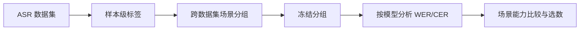

<div align="center">
  <h1>
    <picture>
      <source media="(prefers-color-scheme: dark)" srcset="docs/assets/suretagger-wordmark-dark.png">
      
    </picture>
  </h1>
  <p><strong>看清 ASR 在哪里失效。</strong></p>
  <p>样本级音频标签 · 跨数据集场景 · 按条件评测</p>
  <p><a href="README.md">English</a> &nbsp;·&nbsp; <strong>简体中文</strong></p>
  <p>
    <a href="#演示">演示</a> &nbsp;·&nbsp;
    <a href="#项目动机">项目动机</a> &nbsp;·&nbsp;
    <a href="#工作流程">工作流程</a> &nbsp;·&nbsp;
    <a href="#快速开始">快速开始</a> &nbsp;·&nbsp;
    <a href="#实验结果">实验结果</a>
  </p>
</div>

## 演示

<p align="center"></p>

[样本浏览页面](sure-tagger-main/demo/index.html)支持切换录音、播放音频、查看样本级标签，并检查数据集与标签覆盖情况。项目介绍视频制作完成后也会放在这里。

> **演示视频待发布。** 此源码包不包含生成的演示数据和音频，因此目前没有可直接访问的在线交互演示。

在本地运行页面前，先将选定音频放入 `sure-tagger-main/demo/assets/audio/`，再从对应的 manifest 和 tags-only 输出生成 `data.js`。下面的路径均应位于 `sure-tagger-main/` 内：

```bash
cd sure-tagger-main
python3 scripts/build_demo_data.py \
  --manifest "$PWD/path/to/manifest.jsonl" \
  --tags "$PWD/path/to/tags.jsonl" \
  --audio-dir "$PWD/demo/assets/audio" \
  --output "$PWD/demo/data.js"
python3 demo/serve.py
# 打开 http://localhost:8765
```

## 项目动机

现有 ASR 评测通常给出整个数据集的 WER 或 CER。平均值可能掩盖完全不同的失效来源：说话人重叠、低信噪比、背景音乐、混响，以及语言差异。仅凭数据集名称，很难判断模型在什么声学条件下出错，或者应该增加哪类训练样本。

SureTagger 为已有 ASR 数据集补充**样本级、可追溯的标签**，并按照可观察条件跨数据集组织音频。这样就能按场景而不只是按数据来源比较模型表现，为细粒度 leaderboard 和有针对性的训练选数奠定基础。

## 工作流程



1. **音频打标。** 提取结构化声学、声音事件、说话人和语言标签；可选的语言模型层进行语言核验并补充描述。
2. **条件分组。** 当前 `clustering/` 使用 k-medoids 候选搜索和确定性的 split/merge 规则，输出匿名场景分配及场景画像。
3. **分组后诊断。** 先冻结样本分组，再按模型、语言和有效评分覆盖率分析 WER/CER。默认纯标签流程不使用模型错误率定义场景。
4. **应用结果。** 按场景比较模型并选择训练数据是下游目标；此源码包尚未包含公开的场景 leaderboard。

| 标签维度 | 示例 | 描述 |
| --- | --- | --- |
| 基础声学与质量 | 时长、非语音占比、SNR、DNSMOS | 片段长度、语音密度、噪声和感知质量 |
| 空间声学 | RT60、C50 | 混响衰减与语音清晰度 |
| 声音事件 | 音乐、歌声、背景噪声类别 | 干扰声类型 |
| 说话人结构 | 人数、轮换、重叠比例 | 多人交互及同时发言 |
| 语言与文本 | 语种、词数、重复、填充词 | 语言覆盖和文本特征 |

> **当前能力边界：**`room_acoustic.far_field` 仍是预留字段，当前输出 `null`。仅凭 RT60 和 C50 不能确定远近场、录音地点或设备类型。

## 仓库结构

| 目录 | 内容 |
| --- | --- |
| [`sure-tagger-main/`](sure-tagger-main/README.md) | 样本级打标流水线、schema、模型适配器和测试 |
| [`compare/`](compare/dataset/benchmark/README.md) | 650 条结构性 benchmark、描述性评分和完整运行入口 |
| [`clustering/`](clustering/README.md) | 标签驱动的 k-medoids 分组及冻结分组后的 WER/CER 诊断 |

仓库提供打标、benchmark 评分、场景聚类和错误率诊断代码。模型权重、完整音频数据、私有运行环境、API 凭据与运行结果不包含在这个源码包中。

## 快速开始

### 生成样本标签

输入是 raw-only JSONL manifest。模型和运行环境需按[主程序说明](sure-tagger-main/README.md)在本机配置；输入约束与字段定义见[标签与方法文档](sure-tagger-main/docs/tags-and-methods.md)。

```bash
cd sure-tagger-main
python3 scripts/run_tagger.py \
  --manifest /path/to/manifest.jsonl \
  --output /path/to/tags.jsonl
cd ..
```

### 跨数据集场景分组

标签、样本索引和 manifest 必须包含相同样本，且行序一致。下面的命令从仓库根目录运行，不读取 WER/CER。完整输入契约和可选诊断命令见[聚类说明](clustering/README.md)。

```bash
python3 clustering/scripts/cluster_scenes.py \
  --tags /path/to/tags.jsonl \
  --index-map /path/to/index_map.jsonl \
  --sampled-manifest /path/to/manifest.jsonl \
  --output-dir /path/to/scene-clusters \
  --cluster-methods kmedoids --k-min 6 --k-max 12 --seeds 0,1,2 \
  --no-wer-filter --skip-diagnostics
```

输出包括 `cluster_assignments.jsonl`、`cluster_summary.json` 和 `run_metadata.json`。聚类与后续错误率诊断仅依赖 Python 3.9+ 标准库，不需要 GPU；打标需要已配置的模型与运行环境。

### 运行 benchmark

单卡和八卡入口会运行结构标签、描述生成与评分。运行模型和 API 阶段前，先检查外部 benchmark、runtime 与 GT 是否齐全：

```bash
export PYTHON_BIN=/path/to/python
export BENCHMARK_ROOT=/path/to/benchmark
export RUNTIME_ROOT=/path/to/runtime
export GT_ROOT=/path/to/descriptive_gt
export DEEPSEEK_API_FILE=/private/deepseek-api.txt
export OUTPUT_ROOT=/path/to/new_output

bash compare/eval/run_sure_tagger_pipeline_1.sh --check-inputs
bash compare/eval/run_sure_tagger_pipeline_1.sh
# 八卡入口：compare/eval/run_sure_tagger_pipeline_8.sh
```

当前 benchmark 包含 650 条样本；只有设置 `ALLOW_FROZEN_GT_EXCLUSIONS=1` 时，语义评分才可沿用原冻结 GT 的 648 条口径。详情见[benchmark 文档](compare/dataset/benchmark/README.md)和[入口脚本](compare/eval/run_sure_tagger_pipeline.sh)。

## 实验结果

正式验证过的场景结果将在这里发布。每个场景的比较应同时给出样本数、标签覆盖率、语言构成、各模型有效评分覆盖率、WER/CER，以及对应的数据集整体基线。

| 场景分布 | 各场景模型能力对比 |
| :---: | :---: |
| *图表待发布* | *图表待发布* |

<!-- 将验证后的图表放入 docs/assets/，再替换上面的占位内容。 -->

## 文档

- [标签字段、方法和 JSON 示例](sure-tagger-main/docs/tags-and-methods.md)
- [场景分组方法与错误率使用边界](compare/docs/multi-data-scene-classification.md)
- [Benchmark 数据构成](compare/docs/benchmark-650-dataset-composition.md)
- [评分标准](compare/dataset/benchmark/SCORING_STANDARD.md)

```bash
cd sure-tagger-main && python3 -m unittest discover -s tests
cd ..
python3 -m unittest discover -s compare/eval/tests
python3 compare/eval/test_sure_tagger_pipeline_launchers.py
PYTHONDONTWRITEBYTECODE=1 python3 -m unittest discover -s clustering/tests -p 'test_*.py'
```
