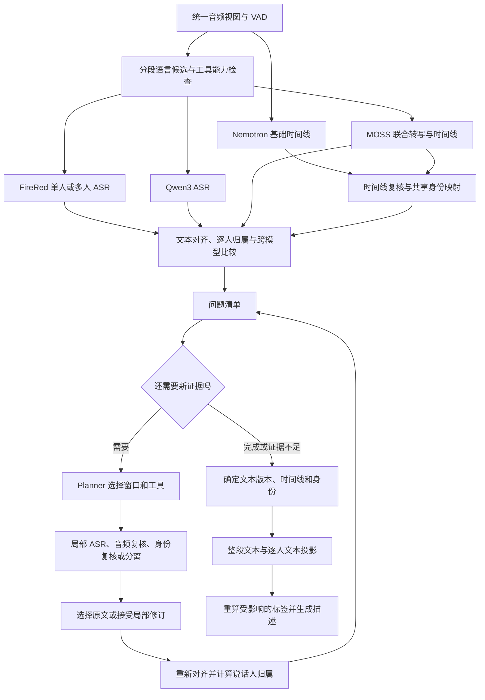

# 多轮工具调用与逐说话人 ASR 计划

日期：2026-10-09  
状态：待实施；本轮完成代码核查与方案设计，未执行模型推理。

## 1. 目标

围绕 [目标 tag schema](../../compare/docs/tag-schema.md)，将当前一次执行的链路扩展为
“首轮分析 → 发现疑点 → planner 选择验证工具 → 定向重跑 → 接受或拒绝新证据”的循环。
优先解决逐说话人转写：MOSS、FireRed、Qwen3 三种文本来源都能形成
`speaker.speaker_transcripts[{speaker_id, text}]`，并允许模型提出和验证 ASR 修复。

新方案不继承旧 ASR 路由的人数和语言分支限制。**FireRed 与 Qwen3 均默认结合 Nemotron
时间线；FireRed 直接参与其支持语言的多人转写。** MOSS 提供独立的联合转写和时间线候选。
支持按语言能力并行运行多个 ASR，再交叉验证；三路是否参与取决于具体音频窗口的语言、
工具能力和资源预算，不要求所有语言都凑齐三路。

文字、时间、身份分别判断：文本来自 ASR 及经过音频核验的修订；时间来自有质量标记的
对齐；说话人来自可靠时间线与身份映射。一个环节失败，不自动丢弃另外两个环节的有效证据。
最终描述模型读取已确定的结构标签，继续只负责描述与现有授权的语言核验。
语言核验产生的路由变化须回到证据循环处理，再冻结结构标签和生成描述，不能在发布末端
直接修改语言而跳过依赖检查。

## 2. 当前代码能做什么

以下结论来自本轮代码与本地模型接口检查，不能替代实测准确率。表内旧路由仅记录迁移
起点；新方案的文本来源和时间线组合以第 3、4 节为准。

| 部件 | 已有能力 | 本次需要补齐的部分 |
| --- | --- | --- |
| [当前 ASR 路由](../tagger/pipelines/speaker_evidence.py) | 代码中的旧策略：首轮运行 MOSS、Nemotron 和 LID；中英文且两个有效人数均不大于 1 时选 FireRed，否则中英文选 MOSS；其他、混合、未知语言选 Qwen3。发布时间线仍按中英文取 MOSS、其余取 Nemotron，与文本来源选择分开。 | 替换互斥路由为语言能力约束下的候选调度；FireRed/Qwen3 默认配 Nemotron，FireRed 不设单人准入限制。旧策略仅保留作评测基线。 |
| [FireRed adapter](../tagger/tools/speaker_v2/firered_asr.py) | 已启用 `return_timestamp=True`，保存字/词时间戳及全文。单人限制来自当前路由策略，模型并不要求整段录音只能有一人；交替发言可作为 ASR 输入。 | 标记真实对齐和近似时间戳，允许多人录音及局部窗口作为候选输入。单流 ASR 不保证识别重叠中的每个人。 |
| [Qwen3 adapter](../tagger/tools/speaker_v2/qwen3_asr.py) | 默认 `return_time_stamps=True`，已接本地 Qwen3-ForcedAligner；collector 将结果转换为 `lexical_units`。 | 将 ASR 与对齐状态解耦；给修订文本增加独立 `align(audio, text, language)` 工具；先检查语言支持范围。 |
| [现有词区间投影](../tagger/tools/speaker_v1/lexical.py) | `project_asr_track()` 已将词区间映射到时间线；结果保存在 `fusion.speaker_text_tracks`，目前仅用于诊断。v2 的 lexical 模块引用这份实现。 | 改为可验证的发布规则，补充覆盖率、重叠、边界稳定性、身份映射和失败语义。 |
| [时间线汇总](../tagger/tools/speaker_v1/timeline.py) | 已区分原始活动视图 `activity_segments`、连续话轮视图 `segments`，以及未经过报告时长门槛筛选的 `overlap_activity_segments`。 | 归属判断使用真实活动视图。当前投影读取可能桥接同人 0.3 秒间隙的 `segments`，不适合直接用于词归属。 |
| [画像文本分配](../tagger/tools/speaker_v2/speaker_profile.py) | 当前存在按最大相交时长把文本分配给说话人的逻辑。 | 逐说话人 ASR 不能直接复用整句分配规则；跨人的句子必须拆到可验证的字/词或稳定发言段。 |

需先修复三个具体问题：

1. **FireRed 的时间戳可能是均匀分配的。**
   [上游 `_get_and_fix_timestamp`](../models/FireRedASR2S/fireredasr2s/fireredasr2/asr.py)
   在 CTC 对齐失败时，把 token 均匀铺到整段时长。目前 collector 只看有没有时间戳，就标为
   `native`。应从生成端透传真实方法与失败原因；无法追溯的历史时间戳标为未知质量，
   不能仅靠“看起来不均匀”判为可信。均匀回退时间戳不能用于逐词说话人归属。
   此外，当前 adapter 的时间戳校验异常会令整条结果失败；需拆开文本与时间戳校验，
   保留有效文本，只将对齐标为失败、清除不可用的 `lexical_units` 并记录原因。
2. **Qwen 的 ASR 与对齐支持范围不同。**
   ASR 模型卡列出 30 种语言和 22 种中文方言；ForcedAligner 只声明支持中、英、粤、法、
   德、意、日、韩、葡、俄、西 11 种语言。本地 SDK 没有严格阻止其他语言进入 aligner，
   所以返回时间戳也不能证明该语种的对齐可信。对齐出错目前还可能使已生成的文本一起失败。
3. **不同工具可能使用不同声道。**
   FireRed/Qwen 通常下混单声道，Nemotron 当前取第 0 声道。先统一被分析的音频视图，或
   明确登记逐声道关系；否则 ASR 听到但时间线未覆盖的声音会被错误分配。

本地已确认 Qwen ASR 和完整 ForcedAligner checkpoint 存在，专用 Python 可导入相关类，
CUDA 可用。本轮未加载模型权重或运行推理。模型卡对齐长度上限为 5 分钟，本地 SDK 的
带时间戳转写实际按 180 秒切块；第一版独立对齐工具以不超过 180 秒为硬上限，并优先使用
更短的连续语音窗口，不承诺词级时刻精度。

## 3. 总体流程



循环开始时可以先做初步归属以定位疑点；发布时必须保证最终文本版本对应自己的对齐结果。
文字修订后旧时间戳失效，时间线修订后旧说话人归属失效。

Nemotron 是 FireRed/Qwen3 的默认时间线，仍需检查漏人、错分和边界误差；MOSS 的联合
结果是可用于复核的另一来源。二者分歧时，通过活动区间、干净声纹锚点及局部重跑裁决，
不能把 Nemotron 的默认地位当作正确性保证。ASR 候选的选取不再自动决定发布时间线。

### 3.1 自适应追加与并行验证

调度器支持两种可比较的配置，使用同一套证据和发布协议：

- **自适应追加**：Nemotron 配一个通过语言能力检查的主 ASR；问题检测或 planner 再追加
  其它适用 ASR。主 ASR 按分语种开发集结果选择，不按人数强制限制 FireRed。
- **并行验证**：对同一录音或连续窗口，同时调度所有符合语言能力要求的 ASR。中英文
  可以评估 MOSS、FireRed、Qwen3 三路并行；其它语言可能只有一路或两路。首轮各自独立
  识别，不把别的模型转写作为提示；planner 主要处理分歧与共同遗漏。

并行配置需记录实际启动模型、跳过原因、GPU 显存和并发上限。资源不足时可排队执行，
保留多个独立候选；不把逻辑上的三路验证写成必须同时常驻三组模型。

### 3.2 语言能力检查

维护独立的 ASR、LID、aligner 和 diarization 能力记录，绑定本地 checkpoint 与工具版本，
记录模型声明范围、项目实测范围和未验证/声明范围外状态。能识别语言名称不等于能转写该语言；
能转写也不等于能提供可靠的词级对齐。模型声明支持仅是候选准入条件，准确率仍须实测。

本地模型卡核实结果：

| 工具 | 声明的能力范围 | 调度约束 |
| --- | --- | --- |
| [FireRedASR2-AED](../models/FireRedASR2-AED/README.md) | 普通话、英语、20 多种中文方言/口音及 code-switching；明确列出粤语、吴语、闽南等。 | 非这些支持语言的结果不参与正式文本裁决；不从同系列 LID/VAD 的 100 多语种能力推断 ASR 能力。混语能力限于已支持语言范围并须实测。 |
| [MOSS-Transcribe-Diarize 0.9B](../models/MOSS-Transcribe-Diarize-model/README.md) | 模型卡声明转写与 diarization 支持 50 多种语言。赛事介绍提及法、日、泰、越、乌尔都等，但本地资料未列出完整 50 多语种清单。 | 不能限制为只支持中英文，也不能把所有小语种直接标为已支持。赛事信息作为逐语种核查线索，不代替当前 checkpoint 的逐项能力确认和本地验证。 |
| [Qwen3-ASR-0.6B](../models/Qwen3-ASR-0.6B/README.md) | 列出 30 种语言、22 种中文方言，包含阿拉伯、泰、越、印地、波斯等。 | 使用模型卡明确清单；乌尔都语、斯瓦希里语不在该清单，不能作为这些语言的可靠验证者。 |
| Qwen3-ForcedAligner | 在同一 Qwen 模型卡中单独列出中、英、粤、法、德、意、日、韩、葡、俄、西 11 语。 | 对齐语言与 ASR 语言分开检查；例如泰语可有 Qwen ASR 文本，但不能据此批准其词级对齐。 |

能力记录分别保存 `support=declared_supported|unverified|outside_declared_scope` 和
`validation=not_tested|calibrated|failed_validation`，以及具体来源。声明范围外表示当前
缺少准入依据，不声称模型绝不可能输出该语言；后续通过独立验证可建立版本化的项目支持
记录。`yue/wuu/nan` 等语言代码和模型方言名称需明确映射，不能只检查 `zh-*` 前缀；
中国境内语言也不能全部视为中文方言。

按连续语音窗口维护语言候选及不确定性，结合 LID 与适用 ASR 的语言结果复核。多人说
不同语言、同人切换语言时，不能用全片主语言屏蔽少数语言段。边界模糊的混合窗口优先用
明确支持相关语言的工具；不能因分别支持两种语言就默认其混合识别质量可靠。

能力未知的模型仅可作为带标记的探索性调用，结果不得作为自动发布或多数表决的依据；
待逐语种验证通过并更新能力记录后才可进入正式候选。声明范围外且没有项目验证的模型
默认跳过。LID 不确定时可调用适用的语言探测工具或多语种模型收集候选，
但不直接以某个强制语言提示下的流畅输出确认语种。只有一路模型适用时，允许输出有证据
的转写并记录缺少跨模型验证；没有可用模型时保留未知，不能让不支持该语种的输出参与裁决。

例如，中英文可评估三路验证；法语/日语可评估 Qwen 与逐语种确认后的 MOSS；乌尔都语
先核验 MOSS 的具体能力并寻求另一适用 ASR，不能让 FireRed/Qwen 的两个不适用结果
压过它。斯瓦希里语在现有材料中没有足够的模型支持依据，先补能力验证或工具。

## 4. 三条 ASR 路径怎样产生逐人文本

| 路径 | 文本候选 | 说话人证据 | 逐人转写方法 |
| --- | --- | --- | --- |
| MOSS | 在已确认支持的语言内独立生成联合转写候选 | MOSS joint 时间线，与 Nemotron 及声纹锚点复核 | 将原始联合结果映射到共享身份表；文本与归属分别核验，可接受其它适用 ASR 的有证据修订。 |
| FireRed | 支持语言内的全段/连续窗口 ASR，单人和多人均可参与 | 默认 Nemotron 时间线 | 验证原生时间戳；需要时用适用 aligner 重对齐。按字/词映射 Nemotron 说话人，再按共享 ID 汇总。 |
| Qwen3 | 支持语言内的全段/连续窗口 ASR | 默认 Nemotron 时间线 | 11 种受支持对齐语言走词级映射；其余 ASR 支持语言走稳定单人连续段的局部 ASR，先交付段级归属。 |

### 4.1 提升 MOSS 路径的文本准确率

优先验证 **Nemotron 时间线 + FireRed 中英文多人转写**，并与 MOSS 联合结果及
Nemotron + Qwen3 比较。MOSS 不再是中英文多人文本的默认唯一来源。其文本和时间线
分别保留为证据；既不预设 MOSS 分人正确，也不预设 FireRed 文本总是更准确。

选取稳定单人连续段重跑 ASR，恢复被 MOSS 漏掉或误识别的词。若新文本只被语义支持、
未被音频支持，不接受修复。MOSS 的旧整句时间戳不能直接挂到新文本上。

### 4.2 FireRed 直接参与多人任务

FireRed 的调用条件是语言适用、音频有效和预算允许，不再要求 MOSS/Nemotron 人数均
不大于 1。多人录音可首轮直接参与：对整段或连续窗口识别，按可靠词时间戳映射 Nemotron
活动区间。边界不可靠、文本分歧或发生漏识别时，再对具体发言段重跑。

“整段转写”是逻辑任务，不表示把长录音一次送入 AED。[本地 FireRed 模型卡](../models/FireRedASR2-AED/README.md)
声明单次输入上限 60 秒，超过可能产生幻觉。每次实际输入连同 padding 必须不超过
60 秒；优先在静音或稳定边界分块，必要时用带重叠的连续窗口，记录偏移并去重。窗口
可以包含多人交替发言，不要求先拆成单人；过长的单人发言也必须分块。

FireRed 没有自带 speaker ID，并不妨碍它为多人
交替发言提供文字；真正需要额外处理的是同时重叠的多路语音。

确认恰好一人是这个统一流程的简化情形：有效整段 ASR 可直接归给 `speaker_1`，无需
强制词级对齐；无语音幻觉仍须检查。零人与未知人数不能作为这个简化处理的依据。

### 4.3 Qwen3 的语言门控与段级回退

ASR、aligner 分别维护能力表。ASR 支持而 aligner 不支持的语言，保留 ASR 文本，不发布
未经支持的词级时间证据。用可靠时间线取出目标说话人的连续、非重叠发言段，逐段识别后
汇总到该说话人。这已能满足公开 schema 的逐人文本要求。

没有可靠词级对齐时，输入窗口只包含目标说话人的稳定发言及静音上下文；不能加入另一人的
声音后，把窗口的全部输出仍归给目标。若必须使用包含其他人声音的上下文而无法定位输出
词，则该窗口保持归属不确定。超出 ASR 本身支持范围的语言，需要可用且支持该语言的另一
ASR 工具；不能仅因为调度器选中了 Qwen，就把不受支持的结果视为可靠。

### 4.4 多路结果如何相互验证

先按原音频坐标、连续窗口和已核验的共享 speaker ID 对齐候选，再做局部文本比较。
用于比较的归一化文本与原文分别保存；标点或格式差异不应触发无意义重跑，否定词、数字、
专名、短回应、重复和漏词必须保留为实质差异。选取不同模型的局部片段后，需要按第 6 节
重建完整窗口文本并重新对齐，不能直接拼接互不匹配的词时间戳。

分别检查三类问题：

- **文字分歧**：同一窗口的识别不同，由适用模型的独立识别、原音频复核及分语种实测
  可靠性支持选择；不直接比较不同模型的原始 confidence，也不直接以二比一决定真值。
- **归属分歧**：MOSS 联合结果与 Nemotron 投影冲突，复查时间线和身份。FireRed 与
  Qwen3 共用 Nemotron，二者归属一致只说明共享了同一分人证据，不能算两票独立验证。
- **共同遗漏或幻觉**：三路一致仍可能共同漏掉短回应或弱语音，或在音乐/静音上输出相似
  文本。结合 VAD、实际活动区间和音频支持检查，不能用一致性代替覆盖率与真实性验证。

模型关系、共享声学/对齐组件、音频视图和依赖证据都须登记。同模型重复调用、沿用别人
转写的提示、同一文本的再次强制对齐不算新的独立识别证据。多路结果以窗口为单位择优，
不要求整片只能采用同一个 ASR，也不因新模型加入就自动覆盖已有可靠片段。

## 5. 字/词与说话人怎样匹配

### 5.1 先建立统一时间坐标和身份

所有区间都使用原音频秒数。每个裁剪保存源音频 hash、音频视图、全局起止、局部偏移、
重采样参数和父证据。偏移只加一次，分块重叠区的文本按来源和时间去重。

MOSS/Nemotron 的本地 speaker 编号先通过活动区间匹配，必要时通过干净声纹锚点验证。
两模型各自的 `speaker_1` 不天然指向同一人。确认共享身份表后，按首次发言重新编号；
profiles、逐人文本、性别和描述使用同一映射。身份表有变化时，全部相关投影失效重算。

### 5.2 质量检查与归属规则

每个词区间 `w=[start,end]` 先检查：时间戳方法可信、非零时长、不越界、顺序合理，
归一化后的对齐 token 与对应文本版本一致。文本归一化用于匹配，不得删除实际重复、
填充词或改变词义。保留源文本字符位置，渲染时按语言恢复空格及标点，避免将中文逐字
插空格，或将英文词直接粘连。

设 `D_s` 为说话人 s 的真实活动区间并集，`O` 为多人同时活动区间：

```text
coverage(w)    = length(w ∩ union(D_s)) / length(w)
exclusive_s(w)= length(w ∩ (D_s - O)) / length(w)
overlap(w)     = length(w ∩ O) / length(w)
margin(w)      = largest(exclusive_s) - second_largest(exclusive_s)
```

使用 `activity_segments` 和 `overlap_activity_segments`，不能用桥接过静音间隙的
连续话轮视图，也不能忽略仅因低于公开报告时长门槛而被过滤的小重叠。

满足足够语音覆盖、明显单人独占、与次候选有足够差距、无可信重叠且远离不稳定边界时，
才给词分配 speaker ID。开发集可从覆盖率/独占率 0.8、差值 0.5 开始标定；这些是待验证
配置，不是准确率保证。按模型实际边界误差小幅扰动词区间，若归属变化，就触发局部复核。
不使用“只相交 50 ms”或“整句与谁相交最多”作为发布标准。

跨两人发言的长句必须先拆成可靠的字/词，或重新识别为可确定归属的连续发言段。
时间线没有覆盖的词标为未归属，不能分给时间上最近的人。

### 5.3 裁剪重跑

按连续发言段或争议窗口裁剪，保留适量上下文；可从前后各 0.3 秒开始在开发集验证，
但不能以固定 padding 保证上下文纯净。使用词级对齐时，只接收目标核心区内、归属通过
检查的词。没有词级对齐时采用第 4.3 节的纯净窗口规则。

不要先把某个人跨越全片的所有发言拼成长音频再当作原始语流识别；这会改变上下文和时间，
也容易制造不存在的连贯句子。短回应和填充词要单独评估，不能为凑最小时长把其他人的
发言并入该人的文本。

## 6. 允许模型修复 ASR 的具体方式

新增一个上游 ASR 修订工具。它与最终生成 `descriptive` 的模型调用分开，输出的是可核验
的局部编辑候选，例如原文本版本、原字符范围、候选新文本、原音频窗口和候选证据 ID。
保留原始输出与每次修订，不能原地覆盖原文。

接受一次修订的流程：

1. 比较同一音频窗口的真实 ASR 候选，定位替换、插入、删除和漏识别。模型可以利用上下文
   提出修复，但不能将“更通顺”当作充分证据。
2. 对词汇变更调用局部 ASR 或能听原音频的模型复核。音频模型可先在未看到建议文本时
   独立转写，再比较候选，以减轻提示锚定。专名、数字、否定词，以及删除重复/填充词等
   修改都需要音频支持；保持 ASR 的转写目标，不改成编辑后的书面语。
3. 由版本化规则接受或拒绝修订；不直接比较不同模型不可比的原始 confidence。
   没有新增声学支持时保留原有可用候选，或把该处记为无法可靠转写，不能伪造修正后的词。
4. 接受词汇修订后，先合成实际对齐窗口的完整修订文本，再执行
   `align(audio, revised_window_text, language)`。输入文本须覆盖窗口内包括语音 padding
   在内的全部待对齐发言，不能把一个修改子串直接对齐到含其它发言的长音频。记录编辑
   核心区与上下文，完成窗口对齐后再提取核心区结果并检查说话人归属。上下文文本无法
   协调时，缩小到可独立识别的窗口或重新转写整窗；不能强行对齐。只有标点或空白变化且
   token 对应完全不变时，才允许保留原对齐。
5. 对齐失败时保留文本候选和失败原因；稳定单人窗口可保留段级归属，多人窗口不可继续
   使用旧词时间戳分人。

**强制对齐只解决给定文本的时间位置，不能证明文本识别正确。** Qwen ASR 与其后接
ForcedAligner 也不算两份独立识别证据。尤其不能先由 LLM 猜一句话，再用“对齐成功”证明
猜测正确。

## 7. 重叠语音与仍然无法归属的内容

同一时间区间有两人在说话时，单流 ASR 加时间戳不足以判断每个词属于谁，也不能恢复
根本没被识别出的较弱一方。不能复制同一组词给两人，也不能强行交给占时更长的一人。

Planner 可依次检查原始多声道是否提供分离信息、追加 joint 模型复核，或调用已部署且适用
的目标说话人提取/语音分离工具。分离流是新的音频视图，需检查泄漏、失真和跨窗身份，
利用非重叠声纹锚点关联到共享 ID，并回到原混音验证修订内容。分离组件尚不是本计划
已确认可用的本地能力，接入前需要独立部署和质量验证。

仍无法确认的词留在内部 `unassigned`/`ambiguous` 记录，不进入任意人的汇总文本。
可靠的整段文本可以保留这些词。逐人结果的缺失计入覆盖率和删除错误，不能在评测中静默
忽略困难区间。

## 8. Planner 的行动协议与内部状态

Planner 每轮接收紧凑的标签候选、问题清单、相关区间、证据引用、工具能力和剩余预算。
必要时读取完整证据。候选清单同时记录语言适用性、共享时间线/模型依赖、尚未调用的
适用工具和跳过原因；planner 可选择并行核验多个独立窗口或同窗的不同 ASR。
一次行动必须绑定具体问题和预期新增信息：

```json
{
  "issue_id": "asr_disagreement_01",
  "target_fields": ["speaker.speaker_transcripts"],
  "tool": "transcribe_window",
  "arguments": {
    "source": "firered",
    "start_sec": 12.4,
    "end_sec": 17.8
  },
  "question": "核验 MOSS 在该窗口中漏掉的否定词"
}
```

工具表至少提供 `inspect_evidence`、`transcribe_window`、`align_text`、
`propose_asr_edit`、`verify_audio_text`、`compare_speakers`、`rerun_diarization`。
分离工具只在能力检查通过后注册。工具执行器校验参数、范围和语言；独立窗口可并行，
修订→重新对齐→归属必须按依赖顺序执行。

新增内部统一记录 `attributed_asr.v1`，至少保存：

- 音频视图、源 hash、全局窗口及局部偏移。
- ASR 原始候选、文本版本、字符范围、窗口语言候选、来源模型版本及能力检查结果。
- 对齐版本、来源文本 hash、时间粒度、方法、支持范围和失败状态。
- 共享身份表、时间线版本、词或段的归属状态、候选人及覆盖/重叠指标。
- 修订前后差异、父证据、接受/拒绝原因、跨模型分歧和共享依赖及待复核区间。

相同音频、视图、模型、参数、文本版本的重复请求命中缓存，不能当作新的一票。
缓存键必须区分裁剪窗口、对齐文本版本、时间线版本和身份映射。初版可限制每个问题
最多两轮追加验证，同时配置总调用数/总重跑音频秒数上限；预算按样本长度调整。
无可用新验证、连续无进展或预算耗尽时结束，并保留明确的不确定区间。

## 9. 输出与其它标签的联动

最终基于接受的内部词/段记录生成 `speaker.speaker_transcripts`：每个已确认说话人一项，
只按其原发言时间汇总可靠归属的文字；部分可用则输出部分文本，全无可靠文本则该项
`text=null`。身份集合不可用时整个数组为 `null`，确认无人说话时为 `[]`。不把内部状态、
置信度、时间戳或修订原因塞进这个两键公开对象。

对于整段 `speaker.asr_transcript`，新链路可以发布经验证后选中的文本版本，但必须先
版本化更新现有“指定模型原始输出”的来源合同：允许登记的 ASR 修订阶段产生最终文本，
来源和原文保存在内部 artifact。全文按接受记录的原始时间顺序生成，不按 speaker 顺序
拼接；时间相同或重叠时采用固定、可复现的排序约定，不宣称这种线性化还原了并行发言。
没有完整可靠的时序记录时，保留可用的整段 ASR 候选，不从逐人汇总伪造全文。

本次用户允许 ASR 修复，对应的是上游 ASR 证据处理权限；最终描述模型仍不能直接改写
结构文本。当前 v1 已发布数据作为基线，实施时使用新的运行输出和来源策略版本。

显式维护依赖关系：

- 窗口语言改变后，重新检查对应 ASR 候选、aligner 和性别模型是否适用；不再沿用旧的
  “中英文换 MOSS 时间线、其它换 Nemotron”规则。FireRed/Qwen3 默认仍使用已核验的
  Nemotron 时间线；只有时间线质量、适用范围或新增说话人证据要求修订时，才更新它。
  时间线或身份表变化后，关联归属失效。内部保留调度语言证据与文本核验的语言候选；最终描述阶段的
  `language_verification` 若改变语言判断，须作为问题反馈给 planner，重新审计这些依赖，
  通过后才能提交新的结构版本并重生成描述。依赖证据仍可靠时可复用，不要求无条件重跑；
  无法解决时保留冲突和允许的未知值，不能发布来源不一致的标签。
- 文本改变后，相关对齐与逐人归属失效；以该 ASR 为来源的词数、标点、重复、filler、
  filler_ratio、topic 和其它相关描述重算。若统计原本来自输入原生转写，则保留其来源合同，
  不混用两种文本；原生 reference 不进入 ASR 修复提示或裁决过程。
- 时间线或身份改变后，逐人转写、人数、切换、重叠、profiles、gender 对齐及描述重算。
- 语速只使用同一时间范围内、已可靠归属的文本与有效发言时长；有漏识别时不能直接用
  部分文本除以全人发言时长，制造偏低的精确语速。
- 其它标签保留原计划的复核入口：例如 VAD/ASR 语音存在性分歧、AED/DASS 音乐分歧。
  AED 结果改变后重新计算其音乐门控依赖。公式冲突由程序处理，不消耗 LLM 取证预算。

## 10. 实施顺序与代码落点

| 阶段 | 实施内容 | 可验收结果 |
| --- | --- | --- |
| A：时间和文本证据可靠化 | 在 FireRed 生成端及 adapter 透传时间戳方法；拆分 FireRed 文本/时间戳校验及 Qwen ASR/对齐状态；登记音频视图与语言能力；增加独立 `forced_aligner.py` 工具。 | 对齐失败不丢文本；不受支持或合成时间戳不参与逐词归属；裁剪偏移可验证。 |
| B：三路统一逐人输出 | 在现有 `speaker_v2` 包中增加 `transcript_assignment.py`、`transcript_projection.py`；FireRed/Qwen3 默认用 Nemotron；MOSS 映射到共享身份表；移除 FireRed 的单人调用门槛并落实含 padding 不超过 60 秒的分块。 | FireRed 直接处理支持语言的多人任务并输出逐人文本；Qwen 支持对齐的语言可词级归属，其余可输出可靠段级归属；MOSS 联合结果可独立比较。 |
| C：并行验证与 ASR 修订 | 增加语言能力表、候选调度器、跨模型比较、`asr_revision.py`；支持自适应追加和所有适用 ASR 并行两种配置；对分歧、共同遗漏和身份冲突定向重跑。 | 中英文可三路比较；其它语言只启用适用模型；共用 Nemotron 不被算作独立分人验证；接受文字修订后重对齐并保留裁决记录。 |
| D：多轮 planner 与全标签联动 | 在 `speaker_evidence.py` / `tagging.py` 的证据执行和最终输出之间加入循环、依赖失效与缓存；最终 resolver 显式选取新证据版本。 | 新证据确实可以改变候选结果；重复调用不会仍选旧的第一条 evidence；全部受影响标签来自同一最终状态。 |
| E：重叠增强 | 在基础归属可靠后接入适用的声道/分离/目标说话人提取，并独立评估。 | 报告重叠区文字和身份收益，分离失败仍可保留原证据。 |

实施 B 时同步更新 `tagging.py` 的字段初始化、stage/tag map、auditor，compare 的结构字段
白名单、canonical adapter、输出校验和相应 prompt；将 schema 中“尚未接入”的说明替换为
真实实现。新增逐人 ASR 的评测轴应单独版本化，不擅自并入已有 29 轴分数。

`speaker_v2/lexical.py` 当前引用冻结实现，宜在新模块中实现发布级归属，保留旧诊断
artifact 的可读取性。现有全样本 evidence scope 不接受裁剪结果直接混入：需要明确的
window evidence，再投影为原样本坐标和共享身份下的记录，不能把局部人数当作全段人数。

## 11. 验证与取舍

先制作带人工逐人转写/身份标注的开发子集，覆盖：中英文单人、中英文多人交替、短回应、
多人重叠、长音频、背景音乐、11 种对齐语言、对齐不支持但 ASR 支持的语言、仅一路模型
支持的语言、语言切换和少数语言发言。按录音/会议
或数据来源隔离开发与最终测试，避免相邻片段泄漏。模型修复不读取 reference。

至少比较以下设置，并在相同音频上记录额外调用成本：

1. 当前 v1 路由；其未实现逐人字段的部分，单独报告整段 WER/CER 和诊断归属基线。
2. 单路基线：Nemotron + FireRed、Nemotron + Qwen3，以及 MOSS 联合结果，各自仅评估
   支持语言；比较 FireRed 多人能力，不加模型修复。
3. 统一归属 + 固定规则定向重跑。
4. 统一归属 + 自适应 planner + 经音频验证的修复。
5. 所有适用 ASR 并行 + 跨模型验证 + planner 局部重跑；报告每个语种实际参与的模型，
   不对不支持语言强行运行三路。

除准确率优先的完整并行配置外，另设相同总推理预算的自适应/并行对照，检查额外收益
来自调度策略还是更多计算。固定 Nemotron 时间线比较 FireRed/Qwen 文本质量，再单独
评估 MOSS/Nemotron 时间线复核的作用，避免混淆文本改进和分人改进。

指标按语言、方言及语言切换分组，同时报告整段 WER/CER、逐人 WER/CER、cpWER、
词的错误归属率、短回应/重叠子集结果、
修复改对/改错数量、文本覆盖率、未归属比例、schema 违规率、工具调用数和延迟。
cpWER 可排列 speaker，必须再报告共享身份映射下的错误归属率，防止“整人交换”被掩盖。
逐人漏识别和拒判内容计入完整 reference 的删除错误，同时展示可靠输出上的准确率。

必须有独立边界用例：合成时间戳、多语种不支持对齐、FireRed 坏时间戳但文本有效、
Qwen 对齐失败但 ASR 成功、修改后沿用旧
时间戳、词跨换人点、真实重叠、小于报告门槛的重叠、crop 偏移、跨窗重复词、局部 speaker ID
变化、中文 token 渲染、修订子串与对齐窗口上下文不匹配、语言核验改变候选模型资格、
旧语言路由不应隐式切换时间线、FireRed 实际输入超过 60 秒、方言代码与能力表不匹配、
FireRed/Qwen 共用时间线被重复计票、三路共同漏词、
不支持语言的输出被误用作修复证据、原生转写与 ASR 来源不同。没有新证据时停止的行为
也需要验证。

第一阶段的决策重点是：**先验证 Nemotron + FireRed 的多人转写与三路统一归属，再衡量
适用模型并行验证及模型修复的净收益。** MOSS 保留有用的联合线索；语言能力约束下的
单路、双路、三路候选进入同一套可追踪、可复核的逐说话人转写过程。
